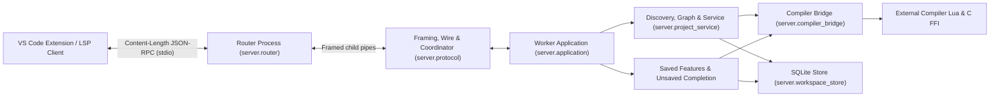

# Inside `vscode-titan`: Building a Language Server in Titan

`vscode-titan` ships a VS Code extension and a standalone stdio language server for [Titan](https://github.com/mascarenhas/titan), written in Titan itself. The server totals roughly 30,000 lines of production Titan across 46 logical modules (62 `.titan` source files, including five multi-file folder modules), verified by over 31,000 lines of native `titan.test` suites alongside a thin TypeScript client in [`src/extension/`](../src/extension/extension.ts).

As a real systems application, the codebase exercises Titan's core abstractions together under production constraints: static nominal types across dynamic JSON and Lua boundaries, folder-module encapsulation, `const` value records and read-only array views, exhaustive tagged unions, structural `io` interfaces, cooperative `async` Tasks with deterministic cancellation, SQLite persistence, and C FFI. This guide walks through the server from its process boundary down to incremental storage and unsaved completion, pairing each architectural decision with the Titan code that implements it.

For installation, editor settings, `titan-config.lua` reference, and standalone client setup, use the task-oriented guides:

- [Using the Titan VS Code Extension](vscode-extension.md)
- [Using the Standalone Language Server](language-server.md)
- [Codex Plugin and Query Client](codex.md)

## System architecture

One native executable runs in two modes. The default **router** process owns the client stdio session, tracks workspace roots, and supervises isolated per-root **worker** processes. Each worker loads one root's selected compiler Lua modules and C-header environment, indexes saved files into SQLite `main.*` tables, and runs private unsaved completions in connection-local `temp.*` tables.

## Codebase map

The 46 logical production Titan modules (plus five C/header helpers and eight TypeScript extension modules) divide into five architectural layers.

### 1. Entrypoint, multi-root routing, and configuration

- `titan_language_server` ([`src/titan_language_server.titan`](../src/titan_language_server.titan)) — CLI flags (`--worker`, `--root`, `--compiler-root`, `--target`, `--print-paths`), logging bootstrap, and mode dispatch.
- `server.router` *(folder module, 4 files)* — Multi-root session router: [`router.titan`](../src/server/router/router.titan) (state, types, session loop), [`client_routing.titan`](../src/server/router/client_routing.titan) (root ownership, forwarding, `titan/workspaceStatus`), [`worker_lifecycle.titan`](../src/server/router/worker_lifecycle.titan) (spawn, crash accounting, settings revalidation, idle eviction), [`overlays_and_diagnostics.titan`](../src/server/router/overlays_and_diagnostics.titan) (buffer replay, diagnostic reconciliation, session indexing status).
- `server.worker_process` ([`src/server/worker_process.titan`](../src/server/worker_process.titan)) — Child worker launch (`os.spawn`), framed stdio relay Tasks, stderr log forwarding, and bounded shutdown.
- `server.roots` ([`src/server/roots.titan`](../src/server/roots.titan)) — Symlink-canonical path identity, root membership (`folder`, `discovered`, `released`), nearest-ancestor config discovery, and most-specific containment.
- `server.root_settings` ([`src/server/root_settings.titan`](../src/server/root_settings.titan)) — Per-root SDK trust policy, prefix layout validation, reinstall stat fingerprinting, and `TITAN_PREFIX` probe isolation.
- `server.project_config` ([`src/server/project_config.titan`](../src/server/project_config.titan)) — Sandboxed Lua evaluation of `titan-config.lua` and `titan-config.local.lua` into normalized `ProjectConfig` records.
- TypeScript extension (`src/extension/`) — [`extension.ts`](../src/extension/extension.ts), [`clientConfig.ts`](../src/extension/clientConfig.ts), [`workspaceUris.ts`](../src/extension/workspaceUris.ts), [`uriPaths.ts`](../src/extension/uriPaths.ts), [`indexingProtocol.ts`](../src/extension/indexingProtocol.ts), [`indexingStatus.ts`](../src/extension/indexingStatus.ts), [`outputChannel.ts`](../src/extension/outputChannel.ts), [`serverLog.ts`](../src/extension/serverLog.ts).

### 2. Framing, JSON-RPC transport, and cooperative concurrency

- `server.framing` ([`src/server/framing.titan`](../src/server/framing.titan)) — Bounded incremental `Content-Length` framing over `io.Reader` and `io.Writer`.
- `server.wire` ([`src/server/wire.titan`](../src/server/wire.titan)) — `titan.json` codecs with an explicit null sentinel, hoisted option spreads, and strict `titan.reflect` projections.
- `server.lsp_types` ([`src/server/lsp_types.titan`](../src/server/lsp_types.titan)) — Nominal LSP parameter parsers, capability readers, and JSON result builders.
- `server.lifecycle` ([`src/server/lifecycle.titan`](../src/server/lifecycle.titan)) — Five-phase `initialize`/`shutdown`/`exit` state machine and capability negotiation.
- `server.dispatcher` ([`src/server/dispatcher.titan`](../src/server/dispatcher.titan)) — JSON-RPC 2.0 envelope validation, nominal `RequestId`, and exhaustive `Route` classification.
- `server.response_queue` ([`src/server/response_queue.titan`](../src/server/response_queue.titan)) — Non-yielding, O(1) cursor FIFO serializing replies onto one writer Task.
- `server.outbound_requests` ([`src/server/outbound_requests.titan`](../src/server/outbound_requests.titan)) — Server-initiated JSON-RPC requests (`titan/<n>`) with bounded client-response waits.
- `server.coordinator` ([`src/server/coordinator.titan`](../src/server/coordinator.titan)) — Per-request Task lifecycle, synchronous pre-Task editor capture, cancellation joins, and terminal publication.
- `server.protocol` ([`src/server/protocol.titan`](../src/server/protocol.titan)) — Acknowledged stdin reader Task, serialized stdout writer Task, and ordered session teardown.
- `server.logging` ([`src/server/logging.titan`](../src/server/logging.titan)) — Severity-filtered structured JSON log lines queued to a dedicated stderr writer Task.

### 3. Compiler bridge, Lua interop, and C FFI

- `server.compiler_bridge` *(folder module, 7 files)* — Typed boundary over the external Titan compiler: [`compiler_bridge.titan`](../src/server/compiler_bridge/compiler_bridge.titan), [`loader.titan`](../src/server/compiler_bridge/loader.titan), [`headers_and_providers.titan`](../src/server/compiler_bridge/headers_and_providers.titan), [`hover_summaries.titan`](../src/server/compiler_bridge/hover_summaries.titan), [`ast_walker.titan`](../src/server/compiler_bridge/ast_walker.titan), [`analysis.titan`](../src/server/compiler_bridge/analysis.titan), [`cache_and_completion.titan`](../src/server/compiler_bridge/cache_and_completion.titan).
- `server.compiler_scheduler` ([`src/server/compiler_scheduler.titan`](../src/server/compiler_scheduler.titan)) — Zero-closure cooperative permit serializing shared compiler Lua state.
- `server.compiler_io` ([`src/server/compiler_io.titan`](../src/server/compiler_io.titan)) — Task-aware filesystem and process I/O userdata proxy injected into the compiler.
- `server.lua_paths` ([`src/server/lua_paths.titan`](../src/server/lua_paths.titan)) — `package.path`/`package.cpath` and `TITAN_*` environment setup before loading compiler Lua.
- `server.documentation` ([`src/server/documentation.titan`](../src/server/documentation.titan)) — Detached LDoc tag rendering and manual-link sanitization.
- `server.embedded_interfaces` ([`src/server/embedded_interfaces.titan`](../src/server/embedded_interfaces.titan)) — Metadata-only standard-library interface provider embedded in the server image.
- `server.selected_interfaces` ([`src/server/selected_interfaces.titan`](../src/server/selected_interfaces.titan)) — Subprocess interface extraction for a selected Windows SDK's `titan.dll`.
- `server.content_identity` ([`src/server/content_identity.titan`](../src/server/content_identity.titan)) — OpenSSL SHA-256 digests over `owned` C buffers and filesystem stat identities.
- C and header helpers — [`compiler_io_clock.c`](../src/server/compiler_io_clock.c), [`compiler_io_clock.h`](../src/server/compiler_io_clock.h), [`compiler_io_platform.h`](../src/server/compiler_io_platform.h), [`embedded_interfaces_native.h`](../src/server/embedded_interfaces_native.h), [`embedded_interfaces_windows.c`](../src/server/embedded_interfaces_windows.c).

### 4. Incremental indexing, provenance, and SQLite storage

- `server.project_discovery` ([`src/server/project_discovery.titan`](../src/server/project_discovery.titan)) — Target-aware flat and folder module discovery under configured source roots.
- `server.project_watcher` ([`src/server/project_watcher.titan`](../src/server/project_watcher.titan)) — Directory watch lifecycle and coalesced change notifications.
- `server.project_graph` ([`src/server/project_graph.titan`](../src/server/project_graph.titan)) — Saved-module dependency graph, checking states, and manifest invalidation.
- `server.project_metadata` ([`src/server/project_metadata.titan`](../src/server/project_metadata.titan)) — Persistent diagnostics, manifests, and external/header provenance tables.
- `server.project_service` *(folder module, 3 files)* — Incremental refresh engine: [`project_service.titan`](../src/server/project_service/project_service.titan), [`scan_and_provenance.titan`](../src/server/project_service/scan_and_provenance.titan), [`analysis_commit.titan`](../src/server/project_service/analysis_commit.titan).
- `server.project_loader` ([`src/server/project_loader.titan`](../src/server/project_loader.titan)) — Production compiler wiring, cache validation, and deferred cached-body `Restoration`.
- `server.workspace_store` ([`src/server/workspace_store.titan`](../src/server/workspace_store.titan)) — Cooperative SQLite connection leases and batched multi-row `INSERT` writers.
- `server.workspace_cache` ([`src/server/workspace_cache.titan`](../src/server/workspace_cache.titan)) — Schema-1 workspace cache compatibility, binary payload staging, and publication reuse.
- `server.header_store` ([`src/server/header_store.titan`](../src/server/header_store.titan)) — Four-scope normalized C-header dependency closure storage.
- `server.source_text` ([`src/server/source_text.titan`](../src/server/source_text.titan)) — UTF-16/byte-offset binary search, path normalization, and file URI conversion.

### 5. Application lifecycle, saved semantics, and private completion

- `server.application` *(folder module, 4 files)* — Per-root worker core: [`application.titan`](../src/server/application/application.titan), [`handlers.titan`](../src/server/application/handlers.titan), [`indexing_lifecycle.titan`](../src/server/application/indexing_lifecycle.titan), [`watch_filter.titan`](../src/server/application/watch_filter.titan).
- `server.semantic_index` ([`src/server/semantic_index.titan`](../src/server/semantic_index.titan)) — Generation-fenced SQL tables for qualified symbol occurrences and scalar hover facts.
- `server.semantic_features` *(folder module, 3 files)* — Saved-file queries: [`semantic_features.titan`](../src/server/semantic_features/semantic_features.titan), [`hover_and_folding.titan`](../src/server/semantic_features/hover_and_folding.titan), [`rename.titan`](../src/server/semantic_features/rename.titan).
- `server.diagnostics` ([`src/server/diagnostics.titan`](../src/server/diagnostics.titan)) — Diagnostic normalization, push notifications, and pull-report `resultId` encoding.
- `server.published_diagnostics` ([`src/server/published_diagnostics.titan`](../src/server/published_diagnostics.titan)) — Persisted diagnostic rows shared by push notifications and pull queries.
- `server.indexing_status` ([`src/server/indexing_status.titan`](../src/server/indexing_status.titan)) — Custom `titan/indexingStatus` payloads and progress invariants.
- `server.indexing_progress` ([`src/server/indexing_progress.titan`](../src/server/indexing_progress.titan)) — Standard LSP `$/progress` work-done periods per refresh chain.
- `server.document_buffers` ([`src/server/document_buffers.titan`](../src/server/document_buffers.titan)) — Bounded unsaved editor buffers and immutable `Capture` snapshots.
- `server.completion_types` ([`src/server/completion_types.titan`](../src/server/completion_types.titan)) — Typed completion candidates, prepared snapshots, and hover keys.
- `server.completion_discovery` ([`src/server/completion_discovery.titan`](../src/server/completion_discovery.titan)) — Disk-free contributor discovery and generation-fenced saved baselines.
- `server.completion_store` ([`src/server/completion_store.titan`](../src/server/completion_store.titan)) — `PRAGMA temp_store = MEMORY` completion tables and binary-prefix SQL selection.
- `server.completion_service` ([`src/server/completion_service.titan`](../src/server/completion_service.titan)) — Bounded completion preparation, provisional ranking, and debounced live hover.

## Titan feature showcase matrix

Use this index to jump straight to a Titan language or standard-library pattern in production code.

| Titan idiom | Chapters | Showcased in |
| --- | --- | --- |
| Folder modules and main-file initialization frontier | [Ch. 1](server-data-flow.md), [Ch. 3](compiler-bridge.md) | `server.router` ([`router.titan`](../src/server/router/router.titan)), `server.compiler_bridge` ([`compiler_bridge.titan`](../src/server/compiler_bridge/compiler_bridge.titan)) |
| `const` record fields, `const { T }`, and `const? { T }` views | [Ch. 1](server-data-flow.md), [Ch. 4](sqlite-backend-storage.md), [Ch. 6](completion.md) | `ProjectConfig` ([`project_config.titan`](../src/server/project_config.titan)), `Capture` ([`document_buffers.titan`](../src/server/document_buffers.titan)) |
| Named `Record { ... }` calls and bound methods | [Ch. 1](server-data-flow.md), [Ch. 5](semantic-features.md) | `Options` and `serve` ([`titan_language_server.titan`](../src/titan_language_server.titan)), `create` ([`application.titan`](../src/server/application/application.titan)) |
| Tagged unions, named payload parts, and `case` | [Ch. 1](server-data-flow.md), [Ch. 5](semantic-features.md) | `WorkerState` ([`router.titan`](../src/server/router/router.titan)), `SharedCaseName` ([`semantic_index.titan`](../src/server/semantic_index.titan)) |
| Structural `io.Reader` and `io.Writer` Interfaces | [Ch. 2](protocol-and-concurrency.md) | `FrameReader:read` ([`framing.titan`](../src/server/framing.titan)), `write_messages` ([`protocol.titan`](../src/server/protocol.titan)) |
| `titan.json`, `titan.reflect`, and hoisted `const` spreads | [Ch. 2](protocol-and-concurrency.md) | `NullToken`, `decode`, `as_array` ([`wire.titan`](../src/server/wire.titan)) |
| `async` Tasks, `ResumeToken`, `defer`, and cancellation | [Ch. 2](protocol-and-concurrency.md), [Ch. 3](compiler-bridge.md) | `ResponseQueue:take` ([`response_queue.titan`](../src/server/response_queue.titan)), `PendingRequest:wait` ([`outbound_requests.titan`](../src/server/outbound_requests.titan)), `Permit` ([`compiler_scheduler.titan`](../src/server/compiler_scheduler.titan)) |
| `os.spawn` child streams and `for line in io.lines` | [Ch. 1](server-data-flow.md) | `spawn`, `WorkerProcess:read_diagnostics` ([`worker_process.titan`](../src/server/worker_process.titan)) |
| `strings.writer()` and variadic `...: value` forwarding | [Ch. 3](compiler-bridge.md), [Ch. 4](sqlite-backend-storage.md) | `Documentation:markdown` ([`documentation.titan`](../src/server/documentation.titan)), `Batch` ([`workspace_store.titan`](../src/server/workspace_store.titan)) |
| `import "lua"` sandboxing and userdata proxies | [Ch. 3](compiler-bridge.md) | `CompilerIO` ([`compiler_io.titan`](../src/server/compiler_io.titan)), `configure` ([`lua_paths.titan`](../src/server/lua_paths.titan)) |
| `foreign import`, `owned` C buffers, and Lua C API | [Ch. 3](compiler-bridge.md) | `digest` ([`content_identity.titan`](../src/server/content_identity.titan)), `provider` ([`embedded_interfaces.titan`](../src/server/embedded_interfaces.titan)) |
| `sqlite3` leases, `temp.*` tables, and `titanc --test` | [Ch. 4](sqlite-backend-storage.md), [Ch. 6](completion.md), [App. A](native-build.md) | `Store:acquire` ([`workspace_store.titan`](../src/server/workspace_store.titan)), `Store:select` ([`completion_store.titan`](../src/server/completion_store.titan)), [`tests.titan`](../src/server/tests.titan) |

## Table of contents

### Implementation chapters

1. **[Chapter 1: Process Architecture, Multi-Root Routing, and Configuration](server-data-flow.md)** — How one executable splits into a compiler-free router and isolated per-root workers, canonicalizes symlinked roots, enforces SDK trust and compatibility, and wires one production composition path.
2. **[Chapter 2: Framing, JSON-RPC Transport, and Cooperative Concurrency](protocol-and-concurrency.md)** — Polymorphic `Content-Length` framing, strict JSON/reflection decoding, five-state LSP lifecycle validation, O(1) cursor queues with `async.ResumeToken`, synchronous pre-Task state capture, and bounded outbound requests.
3. **[Chapter 3: Crossing the Lua and C Boundaries](compiler-bridge.md)** — The seven-file `compiler_bridge` folder module, zero-closure cooperative permits, narrow Lua AST decoding, DAG-safe traversal, detached LDoc formatting, userdata-proxy isolation, and raw Lua/OpenSSL C FFI.
4. **[Chapter 4: Incremental Indexing, Provenance, and SQLite Storage](sqlite-backend-storage.md)** — Target-aware module discovery, symlink-fenced watching, fixed-point refresh with SHA-256 manifest digests, deferred cached-body restoration, cooperative SQLite leases, batched writers, and four-scope C-header provenance.
5. **[Chapter 5: Saved-File Intelligence — Navigation, Hover, Folding, Diagnostics, and Rename](semantic-features.md)** — Scalar SQL occurrence queries, nominal record vs. multi-part union design, shorthand-preserving rename with compiler preflight, lexer-free comment folding, epoch-fenced view publication, and pull-diagnostic freshness barriers.
6. **[Chapter 6: Unsaved Buffers — Private Completion and Live Hover](completion.md)** — Immutable editor buffer captures, disk-free completion discovery, compiler hole injection, `PRAGMA temp_store = MEMORY` candidate ranking, provisional responses, and debounced live hover over recent edits.

### Engineering appendices

- **[Appendix A: Build System, Static Providers, Testing, and Packaging](native-build.md)** — SDK selection, `titanc --incremental --static` object ownership, `production` vs. `validation` profiles, two-shard native tests, paired browser semantic pack, CI lanes, and the Windows CLANG64 build.
- **[Appendix B: Executable Line Coverage](coverage.md)** — Opt-in `titanc --coverage` aggregate builds, folder-module contributor discovery, and gcov/gcovr reporting.
- **[Appendix C: Performance Measurement and Retired Evidence](benchmarks.md)** — Comparable benchmark rules, server and cache timing scripts, measured conclusions, and permalinks to retired investigation records.
