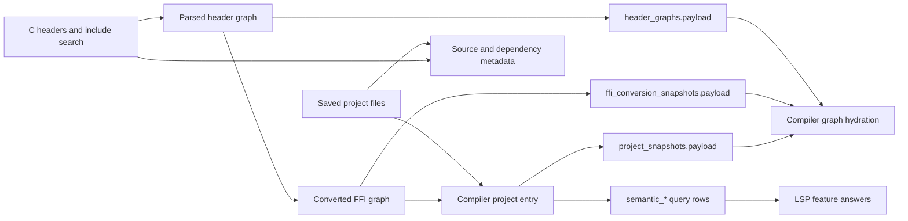

# Workspace SQLite schema and cost investigation

This reference describes schema **3** in vscode-titan commit
[`fe30668`](https://github.com/mascarenhas/vscode-titan/commit/fe30668a4d35435237fa6f319b631dbc20edd24c),
after PR #55, and the compiler persistence format in Titan
[`788b353`](https://github.com/mascarenhas/titan/commit/788b353bed8e2580bbf12bf8ebf4ad9e7f1ab47d).
It covers all **30 application tables and 172 columns**, including compiler
payloads, graph metadata, and the published language-feature index. The database
is `.titan-ls/index.sqlite3` under the resolved workspace root; a failed disk
open uses the same backend in memory. Schema incompatibility rebuilds this
disposable cache. Schema version 3 is independent of the prerelease compiler
language-server API version, which remains 1.

The storage measurements below are a read-only inspection on 2026-09-08 of the
two completed **source-only probe-cache** benchmark databases retained by
[the benchmark report](sqlite-backend-benchmarks.md#raw-source-probe-cache-reconciliation-8-september-2026-utc).
These are the **final retained states after all workloads**, not snapshots of
the cold-ready milestone. No new cold benchmark or optimization was performed
for this document. Byte counts are exact; MB means 1,000,000 bytes and MiB means
1,048,576 bytes.

Navigation: [storage accounting](#storage-accounting) ·
[full table dictionary](#schema-conventions-and-full-data-dictionary) ·
[graph payloads and encoding](#compiler-graph-payloads-and-encoding-work) ·
[graph consumers and two-manifest scope](#what-uses-the-project-graph-and-could-two-manifests-replace-it) ·
[cold time and probes](#cold-start-time-and-compilerprobe-research) ·
[research workflow](#storage-and-serialization-research-workflow) ·
[inspection commands](#reproducing-the-read-only-inspection).

## What explains the size and encoding volume?

The database holds several representations for different consumers:

1. `project_snapshots.payload` restores the compiler's complete checked graph
   for each project module.
2. `header_graphs.payload` restores parsed C-header graphs, and
   `ffi_conversion_snapshots.payload` restores converted FFI graphs.
3. `graph_*`, `project_*`, `external_*`, and header-input tables retain dependency
   topology, source observations, compiler manifests, and diagnostics.
4. `semantic_*` tables answer hover, definition, references, folding, and
   diagnostics from saved files without first hydrating compiler graphs.



The graph payloads overlap in the compiler information they retain; this is a
flow of representations rather than a set of disjoint byte categories.

In the retained Titan database, the first three payload columns alone contain
**807,095,944 bytes (87.88% of the 918,376,448-byte database)**. Their B-tree and
overflow pages occupy 808,140,800 bytes. All indexes combined occupy
24,899,584 bytes; the freelist accounts for 12,697,600 bytes. Reducing index
overhead or reclaiming free pages alone cannot address most of this database.

The **521,217,495 cold encoded bytes** are complete project-module graph
payloads emitted for 63 modules; that counter does not include the separate
header or FFI-conversion payload columns, SQL feature rows, or SQLite journal
and page writes. The **16,303,114 bytes after a saved comment** are one complete
replacement graph for `titan.sqlite3`. The unit of persistence is the owning
module's graph, so volume is governed mainly by that graph rather than the
number of edited bytes.
The encoding section below traces its contents and serialization boundary.

The complete project graph is **the current implementation's checked compiler
snapshot**, rather than the minimum interface needed to import a module.
Ordinary import checking consumes declared type metadata, and ordinary generic
calls do not specialize imported bodies. The consumer audit below supports
investigating two reloadable top-level/type manifests: public and source-visible,
including `local` definitions and local record fields. That requires separating
compiler interface restoration from the server's current regeneration of
unchanged SQL feature rows, and handling source foreign-function companions.
The existing public manifest is reloadable; the existing source manifest is
an equality representation, so those two stored strings are not yet a complete
replacement contract.

## Storage accounting

These figures include overflow pages and all indexes owned by each table.
The final database may retain free pages created while replacing rows. Logical
column bytes count the stored values; allocated bytes count SQLite pages, so
these are separate measures and should not be added together.

| Allocated category | Titan bytes | vscode-titan bytes |
| --- | ---: | ---: |
| `project_snapshots` | 521,814,016 | 148,283,392 |
| `ffi_conversion_snapshots` | 185,520,128 | 5,361,664 |
| `header_graphs` | 100,806,656 | 4,915,200 |
| `semantic_occurrences`, including three indexes | 34,627,584 | 42,962,944 |
| `cached_header_inputs` | 20,766,720 | 622,592 |
| `semantic_hovers`, including its primary-key index | 14,032,896 | 16,617,472 |
| `graph_modules`, including `graph_project_work` | 11,984,896 | 2,195,456 |
| `header_inputs` | 11,399,168 | 204,800 |
| Other allocated tables/indexes, including `sqlite_schema` | 4,726,784 | 5,611,520 |
| Free pages | 12,697,600 | 21,970,944 |
| **Database file** | **918,376,448** | **248,745,984** |

| Physical accounting | Titan bytes | vscode-titan bytes |
| --- | ---: | ---: |
| SQLite serialized record payload, including index records | 894,818,660 | 218,981,611 |
| Unused space inside allocated pages | 7,670,333 | 5,726,220 |
| Page/cell headers, pointers, overflow links and other structural bytes | 3,189,855 | 2,067,209 |
| Allocated pages, subtotal | 905,678,848 | 226,775,040 |
| Free pages retained in the file | 12,697,600 | 21,970,944 |
| **Database file** | **918,376,448** | **248,745,984** |

Both databases use 4,096-byte pages. Titan has 224,213 pages, including 3,100
free pages; vscode-titan has 60,729 pages, including 5,364 free pages. The
physical accounting above reconciles exactly to their file lengths. Index
allocation is already included in the tables above: 24,899,584 bytes for Titan
and 29,933,568 bytes for vscode-titan.

| Logical values | Titan bytes / rows | vscode-titan bytes / rows |
| --- | ---: | ---: |
| `project_snapshots.payload` | 521,196,530 / 63 | 148,043,633 / 62 |
| `ffi_conversion_snapshots.payload` | 185,265,501 / 36 | 5,342,384 / 9 |
| `header_graphs.payload` | 100,633,913 / 36 | 4,900,534 / 6 |
| `project_sources.contents` | 1,323,371 / 135 | 1,492,672 / 62 |
| `semantic_files.contents` | 1,323,371 / 135 | 1,492,672 / 62 |

The two source-content columns deliberately retain two copies for updater and
published-query consumers. In this corpus their combined volume is small
compared with compiler graphs. Module snapshots also repeat imported interface
and provenance data; they are not just source text or the flattened SQL index.

Cold-ready file lengths were 902,270,976 bytes for Titan and 228,319,232 bytes
for vscode-titan. The later final figures include the saved-edit and changed-
header workloads. The separate compiled-probe prefix retains only 357,363 bytes
for Titan and 3,610 bytes for vscode-titan; those files are **outside SQLite**.
Database file length and encoded payload length do not measure cumulative write
traffic or peak rollback-journal/WAL space.

## Schema conventions and full data dictionary

### Conventions

- Database path is `<physical workspace root>/.titan-ls/index.sqlite3`; inaccessible persistence falls back to `:memory:`. `PRAGMA user_version=3`; incompatible schema/root/compiler context is disposable and rebuilt, not incrementally migrated.
- All tables are in `main`. No views, triggers, STRICT tables, generated columns or FTS/virtual tables are declared. 19 tables use WITHOUT ROWID; 11 use ordinary rowid tables (see per-table SQL). All binary-safe names/paths/contents are explicitly bound as `sqlite3.Blob` except graph names/paths and cached_header_inputs.artifact_kind, which use TEXT.
- SQLite declared affinity is not a storage-class guarantee: no STRICT mode or typeof CHECKs apply. The server performs selected read-time type validation, especially for cache payloads. INTEGER boolean/enum conventions are only SQL-enforced where a CHECK is shown.
- WITHOUT ROWID primary keys imply NOT NULL. On ordinary rowid tables, noninteger `BLOB PRIMARY KEY` alone does not imply NOT NULL: semantic_projects.module_name, semantic_files.filename and semantic_summaries.identity remain nullable by SQL, although writers supply bytes. INTEGER PRIMARY KEY aliases rowid, even when PRAGMA reports notnull=0.
- The table below uses PRAGMA notnull exactly, plus PK position; read it alongside the preceding INTEGER/BLOB primary-key caveat. Unspecified defaults mean there is no explicit DEFAULT, not that the writer always permits NULL. The only explicit column DEFAULT is store_state.published_generation=0.
- All FKs are immediate and use default ON UPDATE NO ACTION. ON DELETE CASCADE exists only where listed; remaining FKs use NO ACTION. Foreign keys are enabled/checked when the shared connection opens.
- There is one shared connection with complete-operation leases. Current graph/metadata work and last completed semantic rows have different lifetimes; complete semantic/diagnostic/cache publication commits atomically. Reused warm views do not rewrite semantic rows. Cache header artifact keys have no bounded eviction here; project snapshot rows are revision-pruned.
- Filesystem modification seconds/nanoseconds are separate observations, not generation counters. Compiler locations are one-based lines/byte columns; semantic locations are zero-based lines/UTF-16 columns and exclusive ends. Saved-file byte offsets are zero-based. Ordered-list ordinals are one-based.

### Duplication and lifecycle caveats

- The largest payload families are compiler graphs in project_snapshots, header_graphs and ffi_conversion_snapshots. Their graphcodec envelopes contain full reachable compiler graphs, and encode bytes are cumulative work metrics, not bytes appended to SQLite. A changed source revision replaces the selected project graph BLOB rather than updating only changed SQL facts.
- graph_modules.public_digest/source_digest and external_records.public_manifest/source_manifest contain complete serialized manifests, despite the digest names. These may overlap each other and opaque project/foreign payload contents. external_records.analyzed_identity is a composite string, not a cryptographic hash.
- Full project source contents occur in both project_sources (current updater inputs) and semantic_files (completed query snapshot), and project graph payloads retain compiler AST/type/location state as well (not a full source-text copy). Removing duplication requires preserving the different publication lifetimes.
- graph_files repeats module stamps also held in project_sources or external_files. External scope 0 fingerprints and scope 1 completed metadata can intentionally duplicate path/stamp/topology material.
- header_inputs repeats a dependency list per module owner/scope; cached_header_inputs repeats it per artifact kind/key. Opaque payloads also contain compiler header/dependency graphs; observation columns outside payload permit stat-only refresh without re-encoding them.
- semantic_hovers repeats some occurrence type info; semantic_files.module_order repeats project order. semantic_summaries de-duplicates summary text by module/local id rather than duplicating it on each occurrence.
- semantic_occurrence_inputs is a persistent ordinary rowid CTAS table, not a TEMP table and not a constrained clone. Its 17 columns are nullable; former BLOB columns have no declared type and integer columns are INT. It is emptied before and after every successful publication. Ordinary free pages/high-water file size can persist after DELETE; no VACUUM or auto_vacuum policy is declared by server source.

### Table inventory

[cache_meta](#cache_meta) · [cached_header_inputs](#cached_header_inputs) · [compiler_inputs](#compiler_inputs) · [external_files](#external_files) · [external_import_details](#external_import_details) · [external_observations](#external_observations) · [external_records](#external_records) · [external_sources](#external_sources) · [ffi_conversion_snapshots](#ffi_conversion_snapshots) · [graph_files](#graph_files) · [graph_imports](#graph_imports) · [graph_modules](#graph_modules) · [graph_state](#graph_state) · [header_graphs](#header_graphs) · [header_inputs](#header_inputs) · [header_owners](#header_owners) · [project_diagnostics](#project_diagnostics) · [project_records](#project_records) · [project_snapshots](#project_snapshots) · [project_sources](#project_sources) · [semantic_diagnostic_items](#semantic_diagnostic_items) · [semantic_diagnostic_publications](#semantic_diagnostic_publications) · [semantic_files](#semantic_files) · [semantic_folds](#semantic_folds) · [semantic_hovers](#semantic_hovers) · [semantic_occurrence_inputs](#semantic_occurrence_inputs) · [semantic_occurrences](#semantic_occurrences) · [semantic_projects](#semantic_projects) · [semantic_summaries](#semantic_summaries) · [store_state](#store_state)

### `cache_meta`

Small named compatibility/publication metadata.

Owner/source: [src/server/workspace_store.titan:87](../src/server/workspace_store.titan#L87); read/write evidence: [src/server/workspace_cache.titan:52-108,194-306,338-433,449-478,504-654; src/server/project_service.titan:905-975; src/server/project_config.titan:34-47; src/server/compiler_bridge.titan:4609-4624](../src/server/workspace_cache.titan#L52).

Keys are upserted at cache open, validation and completed publication;
`graph_configuration` also updates in graph-scan transactions independently of
semantic publication. Whole incompatible schema/root/compiler cache is
discarded, not migrated.

| Column | Declared type | NOT NULL | PK position | Explicit default | Meaning |
| --- | --- | --- | --- | --- | --- |
| `key` | `BLOB` | yes | 1 | none | BLOB key bytes. Current keys: compatibility, graph_configuration, native_context, published_revisions. |
| `value` | `BLOB` | yes | — | none | BLOB value for key. compatibility: raw SHA-256 of physical workspace root + NUL + compiler/config compatibility string. graph_configuration: raw SHA-256 of semantic project configuration (root/config path/binary root/FFI flags, include roots, source-module roots and FFI include directories; watcher-only excludes omitted). native_context: raw SHA-256 of driver native-toolchain/version/profile/preprocessor context identity. published_revisions: raw SHA-256 of sorted graph name/provenance/state/revision tuples. All four current values are raw 32-byte SHA-256 digests, with different input recipes. SQL does not restrict key names or digest length. |

Exact table DDL:

```sql
CREATE TABLE cache_meta (key BLOB PRIMARY KEY, value BLOB NOT NULL) WITHOUT ROWID;
```

Indexes:

- Implicit primary-key table b-tree `sqlite_autoindex_cache_meta_1` on (key).

### `cached_header_inputs`

Validated dependency/observation list keyed by cached compiler artifact, separate from its immutable payload.

Owner/source: [src/server/workspace_cache.titan:98](../src/server/workspace_cache.titan#L98); read/write evidence: [src/server/workspace_cache.titan:52-108,194-306,338-433,449-478,504-654; src/server/project_service.titan:905-975; src/server/project_config.titan:34-47; src/server/compiler_bridge.titan:4609-4624](../src/server/workspace_cache.titan#L52).

All rows for (artifact_kind,graph_key) are deleted/reinserted on artifact staging/observation refresh at completed publication. No FK references the artifact tables and no independent prune exists.

| Column | Declared type | NOT NULL | PK position | Explicit default | Meaning |
| --- | --- | --- | --- | --- | --- |
| `artifact_kind` | `TEXT` | yes | 1 | none | TEXT discriminator: c-header-v1 maps to header_graphs; ffi-conversion-v1 maps to ffi_conversion_snapshots. No CHECK. |
| `graph_key` | `BLOB` | yes | 2 | none | Exact BLOB key of the corresponding artifact; logical relation only, not FK. |
| `ordinal` | `INTEGER` | yes | 3 | none | One-based position in the owning ordered list; application convention, no positivity CHECK. |
| `kind` | `INTEGER` | yes | — | none | 0=file (included/preprocessed dependency); 1=search (include-resolution candidate, including a miss). No SQL enum CHECK. |
| `path` | `BLOB` | yes | — | none | Compiler dependency/search-candidate path bytes. Search rows may describe paths that do not exist. |
| `identity` | `BLOB` | yes | — | none | Compiler identity bytes. file: c-header-file-v2:sha256:&lt;hex-content-digest&gt;;lstat=&lt;kind:mode:device:inode&gt;;stat=&lt;same&gt;. search: c-header-search-v1;lstat=&lt;attributes-or-missing&gt;;stat=&lt;attributes-or-missing&gt;;open=readable or unreadable. Identity excludes observation mtime. See c-parser/cpp.lua:103-208. |
| `observed_seconds` | `INTEGER` | no | — | none | Optional whole-second mtime observation; NULL if the compiler supplies no observation. The observation triple is all-or-none. |
| `observed_nanos` | `INTEGER` | no | — | none | Optional subsecond mtime nanoseconds, paired with observed_seconds and physical_identity. |
| `physical_identity` | `BLOB` | no | — | none | Optional compiler physical identity bytes: lstat=&lt;kind:mode:device:inode&gt;;stat=&lt;same&gt;, with missing sentinel as needed; symlink kind normalizes to link. Differs from server FileStamp physical encoding. Observation triple is all present or all NULL by application validation. See c-parser/cpp.lua:103-208. |

Exact table DDL:

```sql
CREATE TABLE cached_header_inputs(artifact_kind TEXT NOT NULL,graph_key BLOB NOT NULL,ordinal INTEGER NOT NULL,kind INTEGER NOT NULL,path BLOB NOT NULL,identity BLOB NOT NULL,observed_seconds INTEGER,observed_nanos INTEGER,physical_identity BLOB,PRIMARY KEY(artifact_kind,graph_key,ordinal)) WITHOUT ROWID;
```

Indexes:

- Implicit primary-key table b-tree `sqlite_autoindex_cached_header_inputs_1` on (artifact_kind, graph_key, ordinal).

### `compiler_inputs`

Small cache of selected compiler/configuration input observations for startup identity validation.

Owner/source: [src/server/workspace_cache.titan:99](../src/server/workspace_cache.titan#L99); read/write evidence: [src/server/workspace_cache.titan:52-108,194-306,338-433,449-478,504-654; src/server/project_service.titan:905-975; src/server/project_config.titan:34-47; src/server/compiler_bridge.titan:4609-4624](../src/server/workspace_cache.titan#L52).

Startup reads only this inventory before accepting semantic cache compatibility. Unchanged observations reuse fingerprint without file reads/hashes; changed inputs are stably read and hashed. Completed inventory replaces all rows in its own small transaction.

| Column | Declared type | NOT NULL | PK position | Explicit default | Meaning |
| --- | --- | --- | --- | --- | --- |
| `path` | `BLOB` | yes | 1 | none | Selected compiler/config input path bytes, one row per input. |
| `observation` | `BLOB` | yes | — | none | Binary lstat + NUL + stat observation. Each side is missing or kind:device:inode:size:mode:modified_seconds:modified_nanoseconds. |
| `fingerprint` | `BLOB` | yes | — | none | Raw 32-byte SHA-256(SHA-256(contents) + physical-input-string). Here physical uses kind:device:inode:size:mode for lstat and stat, so it differs from FileStamp physical_identity. |

Exact table DDL:

```sql
CREATE TABLE compiler_inputs(path BLOB PRIMARY KEY,observation BLOB NOT NULL,fingerprint BLOB NOT NULL) WITHOUT ROWID;
```

Indexes:

- Implicit primary-key table b-tree `sqlite_autoindex_compiler_inputs_1` on (path).

### `external_files`

Input-file/provider stamp lists belonging to either external fingerprint or completed result.

Owner/source: [src/server/project_metadata.titan:134](../src/server/project_metadata.titan#L134); read/write evidence: [src/server/project_metadata.titan:193-563](../src/server/project_metadata.titan#L193).

Replaced per (scope,module), refreshed on metadata-only touches; removed explicitly with owner. No FK. Both scopes can hold similar copies; graph_files can repeat the same stamps.

| Column | Declared type | NOT NULL | PK position | Explicit default | Meaning |
| --- | --- | --- | --- | --- | --- |
| `scope` | `INTEGER` | yes | 1 | none | 0=pre-analysis external resolver fingerprint (external_observations); 1=completed external module metadata (external_records). No SQL enum CHECK/FK. |
| `module` | `BLOB` | yes | 2 | none | Canonical logical Titan module name. Stored as exact byte string; terminal source-import .titan marker is not part of logical identity. |
| `ordinal` | `INTEGER` | yes | 3 | none | One-based position in the owning ordered list; application convention, no positivity CHECK. |
| `path` | `BLOB` | yes | — | none | External source contributor/provider path bytes; no source contents are stored. |
| `seconds` | `INTEGER` | yes | — | none | Filesystem modification time, whole seconds since Unix epoch, from the followed file observation; separate from content identity. |
| `nanos` | `INTEGER` | yes | — | none | Subsecond nanoseconds component of the filesystem modification time. |
| `size` | `INTEGER` | yes | — | none | Observed input length in bytes. |
| `identity` | `BLOB` | no | — | none | Optional raw 32-byte SHA-256 of saved file bytes; NULL means caller has not certified content, so stamp comparisons conservatively use mtime. |
| `physical_identity` | `BLOB` | no | — | none | Optional binary string containing lstat and stat physical identities, separated by NUL; each is kind:device:inode:mode. Distinguishes replacement/symlink retargeting independently of mtime. Not a SHA-256 digest. |

Exact table DDL:

```sql
CREATE TABLE external_files(scope INTEGER NOT NULL, module BLOB NOT NULL, ordinal INTEGER NOT NULL, path BLOB NOT NULL, seconds INTEGER NOT NULL, nanos INTEGER NOT NULL, size INTEGER NOT NULL, identity BLOB, physical_identity BLOB, PRIMARY KEY(scope,module,ordinal)) WITHOUT ROWID;
```

Indexes:

- Implicit primary-key table b-tree `sqlite_autoindex_external_files_1` on (scope, module, ordinal).

### `external_import_details`

Compiler import declarations with aliases and locations for completed external modules.

Owner/source: [src/server/project_metadata.titan:136](../src/server/project_metadata.titan#L136); read/write evidence: [src/server/project_metadata.titan:193-563](../src/server/project_metadata.titan#L193).

Replaced per completed external result; removed explicitly with external owner. Semantic dependency/visibility is also normalized in graph_imports; this table preserves declaration-level detail and order.

| Column | Declared type | NOT NULL | PK position | Explicit default | Meaning |
| --- | --- | --- | --- | --- | --- |
| `module` | `BLOB` | yes | 1 | none | Owning external logical module name; no SQL FK. |
| `ordinal` | `INTEGER` | yes | 2 | none | One-based position in the owning ordered list; application convention, no positivity CHECK. |
| `alias` | `BLOB` | yes | — | none | Local alias spelling in the external source import declaration. |
| `imported` | `BLOB` | yes | — | none | Canonical imported logical module name. |
| `source_required` | `INTEGER` | yes | — | none | Application boolean 0/1 for explicit source-required import; no CHECK. |
| `path` | `BLOB` | yes | — | none | Compiler import declaration filename bytes. |
| `line` | `INTEGER` | yes | — | none | One-based compiler source line. |
| `column_number` | `INTEGER` | yes | — | none | One-based compiler byte column; not UTF-16. |

Exact table DDL:

```sql
CREATE TABLE external_import_details(module BLOB NOT NULL, ordinal INTEGER NOT NULL, alias BLOB NOT NULL, imported BLOB NOT NULL, source_required INTEGER NOT NULL, path BLOB NOT NULL, line INTEGER NOT NULL, column_number INTEGER NOT NULL, PRIMARY KEY(module,ordinal)) WITHOUT ROWID;
```

Indexes:

- Implicit primary-key table b-tree `sqlite_autoindex_external_import_details_1` on (module, ordinal).

### `external_observations`

Pre-analysis resolver/validation fingerprint, including missing or failed external names.

Owner/source: [src/server/project_metadata.titan:133](../src/server/project_metadata.titan#L133); read/write evidence: [src/server/project_metadata.titan:193-563](../src/server/project_metadata.titan#L193).

Upserted from external resolution and validation; scope=0 files/sources are replaced with it. Can retain clean misses/errors. Removed explicitly when unnecessary; differs from accepted external_records.

| Column | Declared type | NOT NULL | PK position | Explicit default | Meaning |
| --- | --- | --- | --- | --- | --- |
| `name` | `BLOB` | yes | 1 | none | Canonical logical Titan module name. Stored as exact byte string; terminal source-import .titan marker is not part of logical identity. |
| `source_required` | `INTEGER` | yes | — | none | Application boolean 0/1: resolver must select source (explicit source-required import); may strengthen an ordinary fingerprint. No CHECK. |
| `topology_resolved` | `INTEGER` | yes | — | none | Application boolean 0/1: source/module contributor topology was resolved through resolver rather than only observed at known paths. No CHECK. |
| `kind` | `INTEGER` | no | — | none | Optional External origin: 0=source, 1=dynamic binary provider, 2=static binary provider. No SQL enum CHECK; different from graph_modules.provenance. NULL means no resolved origin. |
| `main_path` | `BLOB` | no | — | none | Optional resolved main source/provider path bytes; NULL when origin is absent. |
| `error` | `BLOB` | no | — | none | Optional resolver/validation error message bytes; NULL on clean observation. A missing origin can represent a clean miss or an error. |

Exact table DDL:

```sql
CREATE TABLE external_observations(name BLOB PRIMARY KEY, source_required INTEGER NOT NULL, topology_resolved INTEGER NOT NULL, kind INTEGER, main_path BLOB, error BLOB) WITHOUT ROWID;
```

Indexes:

- Implicit primary-key table b-tree `sqlite_autoindex_external_observations_1` on (name).

### `external_records`

Completed metadata-only external module results; no external AST or source contents.

Owner/source: [src/server/project_metadata.titan:132](../src/server/project_metadata.titan#L132); read/write evidence: [src/server/project_metadata.titan:193-563](../src/server/project_metadata.titan#L193).

Upserted after compilation, along with scope=1 child lists/header owner and import details. Pruned/cleared explicitly; no child FKs except header owner to its inputs. Repeats manifests/stamps also retained in graph tables.

| Column | Declared type | NOT NULL | PK position | Explicit default | Meaning |
| --- | --- | --- | --- | --- | --- |
| `name` | `BLOB` | yes | 1 | none | Canonical logical Titan module name. Stored as exact byte string; terminal source-import .titan marker is not part of logical identity. |
| `kind` | `INTEGER` | yes | — | none | External origin: 0=source, 1=dynamic binary provider, 2=static binary provider. No SQL enum CHECK; different from graph_modules.provenance. |
| `main_path` | `BLOB` | yes | — | none | Canonical main source file for source origins, or shared/static provider file path for binary origins. |
| `public_manifest` | `BLOB` | yes | — | none | Complete serialized compiler manifest bytes used for equality/invalidation, despite digest-style naming; not a fixed-size cryptographic digest. Public interface. |
| `source_manifest` | `BLOB` | yes | — | none | Complete serialized compiler manifest bytes used for equality/invalidation, despite digest-style naming; not a fixed-size cryptographic digest. Full source collaboration interface, or public manifest fallback when source-specific serialization is unavailable. |
| `analyzed_identity` | `BLOB` | no | — | none | Optional length-prefixed combination of source stamp material and C-header dependency material used to prove a completed external source result matches validated inputs. Not a hash; NULL for binary results. |

Exact table DDL:

```sql
CREATE TABLE external_records(name BLOB PRIMARY KEY, kind INTEGER NOT NULL, main_path BLOB NOT NULL, public_manifest BLOB NOT NULL, source_manifest BLOB NOT NULL, analyzed_identity BLOB) WITHOUT ROWID;
```

Indexes:

- Implicit primary-key table b-tree `sqlite_autoindex_external_records_1` on (name).

### `external_sources`

Ordered source topology lists for external-source origins.

Owner/source: [src/server/project_metadata.titan:135](../src/server/project_metadata.titan#L135); read/write evidence: [src/server/project_metadata.titan:193-563](../src/server/project_metadata.titan#L193).

Replaced per (scope,module) together with origin. Source origins insert paths; absent/binary origins leave list empty. No FK; deletion is explicit.

| Column | Declared type | NOT NULL | PK position | Explicit default | Meaning |
| --- | --- | --- | --- | --- | --- |
| `scope` | `INTEGER` | yes | 1 | none | 0=pre-analysis external resolver fingerprint (external_observations); 1=completed external module metadata (external_records). No SQL enum CHECK/FK. |
| `module` | `BLOB` | yes | 2 | none | Canonical logical Titan module name. Stored as exact byte string; terminal source-import .titan marker is not part of logical identity. |
| `ordinal` | `INTEGER` | yes | 3 | none | One-based position in the owning ordered list; application convention, no positivity CHECK. |
| `path` | `BLOB` | yes | — | none | Source contributor path bytes in resolver/compiler source-file order. Topology only; no source contents. |

Exact table DDL:

```sql
CREATE TABLE external_sources(scope INTEGER NOT NULL, module BLOB NOT NULL, ordinal INTEGER NOT NULL, path BLOB NOT NULL, PRIMARY KEY(scope,module,ordinal)) WITHOUT ROWID;
```

Indexes:

- Implicit primary-key table b-tree `sqlite_autoindex_external_sources_1` on (scope, module, ordinal).

### `ffi_conversion_snapshots`

Opaque compiler artifact cache for whole-module foreign type conversion state.

Owner/source: [src/server/workspace_cache.titan:97](../src/server/workspace_cache.titan#L97); read/write evidence: [src/server/workspace_cache.titan:52-108,194-306,338-433,449-478,504-654; src/server/project_service.titan:905-975; src/server/project_config.titan:34-47; src/server/compiler_bridge.titan:4609-4624](../src/server/workspace_cache.titan#L52).

Compiler hooks stage successful results; completed publication upserts by key. Validation can refresh dependency observations without replacing payload. No per-artifact eviction/pruning is implemented here; old distinct keys survive until whole-cache rebuild.

| Column | Declared type | NOT NULL | PK position | Explicit default | Meaning |
| --- | --- | --- | --- | --- | --- |
| `key` | `BLOB` | yes | 1 | none | titan-ffi-conversion-v1:sha256:&lt;hex-digest&gt; of length-framed version/module/source_dir/profile identity plus ordered header key/order/name/rendering/dependency/search identities (titan-compiler/foreigncache.lua:36-99). Stored as BLOB bytes; not a SQL FK. |
| `payload` | `BLOB` | yes | — | none | Binary TITAN-GRAPH graphcodec payload. Includes whole FFI conversion unit maps, type/history/macro/tag/include/profile state, node types/includes, enum state and symbolic external graph references; compiler-owned schema. |

Exact table DDL:

```sql
CREATE TABLE ffi_conversion_snapshots(key BLOB PRIMARY KEY,payload BLOB NOT NULL) WITHOUT ROWID;
```

Indexes:

- Implicit primary-key table b-tree `sqlite_autoindex_ffi_conversion_snapshots_1` on (key).

### `graph_files`

Observed input-file stamps owned by each graph module.

Owner/source: [src/server/project_graph.titan:243](../src/server/project_graph.titan#L243); read/write evidence: [src/server/project_graph.titan:305-395,531-789](../src/server/project_graph.titan#L305).

Graph module stamps replace as an ordered-by-path set when inputs change. Timestamp-only refresh updates seconds/nanoseconds/size while certified content and physical identity remain equal. Removed with graph module via cascade.

| Column | Declared type | NOT NULL | PK position | Explicit default | Meaning |
| --- | --- | --- | --- | --- | --- |
| `module_name` | `TEXT` | yes | 1 | none | Canonical logical Titan module name. Stored as exact byte string; terminal source-import .titan marker is not part of logical identity. |
| `path` | `TEXT` | yes | 2 | none | File/provider input path as TEXT COLLATE BINARY. Combined with module_name forms PK; same physical file may belong to several modules. |
| `seconds` | `INTEGER` | yes | — | none | Filesystem modification time, whole seconds since Unix epoch, from the followed file observation; separate from content identity. |
| `nanoseconds` | `INTEGER` | yes | — | none | Subsecond nanoseconds component of the filesystem modification time. |
| `size` | `INTEGER` | yes | — | none | Observed file length in bytes. |
| `identity` | `BLOB` | no | — | none | Optional raw 32-byte SHA-256 of saved file bytes; NULL means caller has not certified content, so stamp comparisons conservatively use mtime. |
| `physical_identity` | `BLOB` | no | — | none | Optional binary string containing lstat and stat physical identities, separated by NUL; each is kind:device:inode:mode. Distinguishes replacement/symlink retargeting independently of mtime. Not a SHA-256 digest. |

Exact table DDL:

```sql
CREATE TABLE graph_files (module_name TEXT NOT NULL REFERENCES graph_modules(name) ON DELETE CASCADE, path TEXT NOT NULL COLLATE BINARY, seconds INTEGER NOT NULL, nanoseconds INTEGER NOT NULL, size INTEGER NOT NULL, identity BLOB, physical_identity BLOB, PRIMARY KEY(module_name,path)) WITHOUT ROWID;
```

Indexes:

- Implicit primary-key table b-tree `sqlite_autoindex_graph_files_1` on (module_name, path).

### `graph_imports`

Direct dependency edges with import visibility, used for reverse invalidation and reachable-external pruning.

Owner/source: [src/server/project_graph.titan:250](../src/server/project_graph.titan#L250); read/write evidence: [src/server/project_graph.titan:305-395,531-789](../src/server/project_graph.titan#L305).

Replaced per importer on accepted compiler result; unique PK deduplicates equal edges. Removing importer cascades edges. Removing imported provider intentionally preserves incoming edges so recovery can wake importers.

| Column | Declared type | NOT NULL | PK position | Explicit default | Meaning |
| --- | --- | --- | --- | --- | --- |
| `importer` | `TEXT` | yes | 1 | none | Owning/importing logical module name; FK graph_modules(name) ON DELETE CASCADE. |
| `imported` | `TEXT` | yes | 2 | none | Imported logical module name; deliberately no FK because unresolved or removed providers must remain edge targets. |
| `visibility` | `INTEGER` | yes | 3 | none | 0=ordinary/public-only import, 1=explicit source-required import; CHECK IN (0,1). One importer can have both kinds to the same imported name. |

Exact table DDL:

```sql
CREATE TABLE graph_imports (importer TEXT NOT NULL REFERENCES graph_modules(name) ON DELETE CASCADE, imported TEXT NOT NULL COLLATE BINARY, visibility INTEGER NOT NULL, PRIMARY KEY(importer,imported,visibility), CHECK(visibility IN (0,1))) WITHOUT ROWID;
```

Indexes:

- `CREATE INDEX graph_reverse ON graph_imports(imported,importer,visibility)` ([src/server/project_graph.titan:255](../src/server/project_graph.titan#L255)).
- Implicit primary-key table b-tree `sqlite_autoindex_graph_imports_1` on (importer, imported, visibility).

### `graph_modules`

Authoritative graph node work/provenance/manifest state.

Owner/source: [src/server/project_graph.titan:237](../src/server/project_graph.titan#L237); read/write evidence: [src/server/project_graph.titan:305-395,531-789](../src/server/project_graph.titan#L305).

Project observation creates dirty nodes, checking marks work in-flight, success stores manifests and clean state, failure retains failed/recovering state. External upsert stores metadata-only clean nodes with revision=0. Remove cascades owned stamps and outgoing edges; incoming edges remain.

| Column | Declared type | NOT NULL | PK position | Explicit default | Meaning |
| --- | --- | --- | --- | --- | --- |
| `name` | `TEXT` | yes | 1 | none | Canonical logical Titan module name. Stored as exact byte string; terminal source-import .titan marker is not part of logical identity. |
| `provenance` | `INTEGER` | yes | — | none | 0=project source, 1=external source, 2=external binary (dynamic and static collapsed). CHECK BETWEEN 0 AND 2. |
| `state` | `INTEGER` | yes | — | none | 0=dirty/retryable, 1=checking, 2=clean/completed, 3=failed. CHECK BETWEEN 0 AND 3. External nodes are written as clean. |
| `recovering` | `INTEGER` | yes | — | none | Application boolean 0/1: failed checking sets 1; a later successful commit resets 0 and wakes failed importers even if manifest equality would otherwise hide recovery. No boolean CHECK. |
| `revision` | `INTEGER` | yes | — | none | Project work revision allocated from graph_state.work_revision; external nodes written as 0. Dirtying changes revision even when published semantic generation has not changed. |
| `public_digest` | `BLOB` | no | — | none | Complete serialized compiler manifest bytes used for equality/invalidation, despite digest-style naming; not a fixed-size cryptographic digest. Public/ordinary import surface; NULL before a successful manifest. |
| `source_digest` | `BLOB` | no | — | none | Complete serialized compiler manifest bytes used for equality/invalidation, despite digest-style naming; not a fixed-size cryptographic digest. Complete source-collaboration surface including public members; NULL together with public_digest by CHECK. |

Exact table DDL:

```sql
CREATE TABLE graph_modules (name TEXT PRIMARY KEY COLLATE BINARY, provenance INTEGER NOT NULL, state INTEGER NOT NULL, recovering INTEGER NOT NULL, revision INTEGER NOT NULL, public_digest BLOB, source_digest BLOB, CHECK(provenance BETWEEN 0 AND 2), CHECK(state BETWEEN 0 AND 3), CHECK((public_digest IS NULL)=(source_digest IS NULL))) WITHOUT ROWID;
```

Indexes:

- `CREATE INDEX graph_project_work ON graph_modules(provenance,state,name)` ([src/server/project_graph.titan:257](../src/server/project_graph.titan#L257)).
- Implicit primary-key table b-tree `sqlite_autoindex_graph_modules_1` on (name).

### `graph_state`

Mutable dependency-graph generation and globally unique project-work revision allocator.

Owner/source: [src/server/project_graph.titan:233](../src/server/project_graph.titan#L233); read/write evidence: [src/server/project_graph.titan:305-395,531-789](../src/server/project_graph.titan#L305).

Singleton created as (1,0,0). Graph changes advance generation; project invalidation/creation allocates work_revision transactionally. Neither counter is elapsed time. Whole database rebuild restarts them.

| Column | Declared type | NOT NULL | PK position | Explicit default | Meaning |
| --- | --- | --- | --- | --- | --- |
| `singleton` | `INTEGER` | no | 1 | none | Exactly 1; INTEGER PRIMARY KEY aliases rowid and CHECK restricts singleton. |
| `generation` | `INTEGER` | yes | — | none | Dependency/input graph generation; increment invalidates old check tokens and returns in-flight project checks to dirty. Distinct from semantic published_generation. |
| `work_revision` | `INTEGER` | yes | — | none | Monotonic allocator for project revision identity, preventing removal/recreation from reusing an old payload revision; incremented in the same graph mutation transaction. |

Exact table DDL:

```sql
CREATE TABLE graph_state (singleton INTEGER PRIMARY KEY CHECK(singleton=1), generation INTEGER NOT NULL, work_revision INTEGER NOT NULL);
```

No separate indexes; INTEGER PRIMARY KEY uses the rowid b-tree.

### `header_graphs`

Opaque compiler artifact cache for parsed/preprocessed C header graphs.

Owner/source: [src/server/workspace_cache.titan:96](../src/server/workspace_cache.titan#L96); read/write evidence: [src/server/workspace_cache.titan:52-108,194-306,338-433,449-478,504-654; src/server/project_service.titan:905-975; src/server/project_config.titan:34-47; src/server/compiler_bridge.titan:4609-4624](../src/server/workspace_cache.titan#L52).

Compiler hooks stage successful results; completed publication upserts by key. Validation can refresh dependency observations without replacing payload. No per-artifact eviction/pruning is implemented here; old distinct keys survive until whole-cache rebuild.

| Column | Declared type | NOT NULL | PK position | Explicit default | Meaning |
| --- | --- | --- | --- | --- | --- |
| `key` | `BLOB` | yes | 1 | none | titan-cdriver-process-v2:sha256:&lt;hex-digest&gt; of length-framed process-v2/preprocessor-configuration/cwd/selected-filename/original/resolved/include-kind/include-name tuple. Caller source_dir omitted because search observations are reconstructed (c-parser/cdriver.lua:603-620). Stored as BLOB bytes; not a SQL FK. |
| `payload` | `BLOB` | yes | — | none | Binary TITAN-GRAPH graphcodec payload. Includes parsed C declaration graph and header/preprocessor/search context; compiler-owned schema. |

Exact table DDL:

```sql
CREATE TABLE header_graphs(key BLOB PRIMARY KEY,payload BLOB NOT NULL) WITHOUT ROWID;
```

Indexes:

- Implicit primary-key table b-tree `sqlite_autoindex_header_graphs_1` on (key).

### `header_inputs`

Exact C-header dependency/search observations attached to module validation/completed external metadata.

Owner/source: [src/server/project_metadata.titan:138](../src/server/project_metadata.titan#L138); read/write evidence: [src/server/project_metadata.titan:193-563](../src/server/project_metadata.titan#L193).

Replaced under header_owners; cascades with owner. Observation refresh matches module/kind/path/identity and deliberately updates matching rows across both scopes.

| Column | Declared type | NOT NULL | PK position | Explicit default | Meaning |
| --- | --- | --- | --- | --- | --- |
| `scope` | `INTEGER` | yes | 1 | none | 0=module header fingerprint used for validation (project and external-source names may occur); 1=header dependencies retained with a completed external module record. No SQL enum CHECK. |
| `module` | `BLOB` | yes | 2 | none | Canonical logical Titan module name. Stored as exact byte string; terminal source-import .titan marker is not part of logical identity. |
| `ordinal` | `INTEGER` | yes | 3 | none | One-based position in the owning ordered list; application convention, no positivity CHECK. |
| `kind` | `INTEGER` | yes | — | none | 0=file (included/preprocessed dependency); 1=search (include-resolution candidate, including a miss). No SQL enum CHECK. |
| `path` | `BLOB` | yes | — | none | Compiler dependency or search-candidate path bytes; search candidates include misses and earlier possible include shadows. |
| `identity` | `BLOB` | yes | — | none | Compiler identity bytes. file: c-header-file-v2:sha256:&lt;hex-content-digest&gt;;lstat=&lt;kind:mode:device:inode&gt;;stat=&lt;same&gt;. search: c-header-search-v1;lstat=&lt;attributes-or-missing&gt;;stat=&lt;attributes-or-missing&gt;;open=readable or unreadable. Identity excludes observation mtime. See c-parser/cpp.lua:103-208. |
| `observed_seconds` | `INTEGER` | no | — | none | Optional compiler-observed whole-second mtime; all observation columns NULL or all present by application validation. |
| `observed_nanos` | `INTEGER` | no | — | none | Optional compiler-observed subsecond mtime nanoseconds. |
| `physical_identity` | `BLOB` | no | — | none | Optional compiler physical identity bytes: lstat=&lt;kind:mode:device:inode&gt;;stat=&lt;same&gt;, with missing sentinel as needed; symlink kind normalizes to link. Differs from server FileStamp physical encoding. Observation triple is all present or all NULL by application validation. See c-parser/cpp.lua:103-208. |

Exact table DDL:

```sql
CREATE TABLE header_inputs(scope INTEGER NOT NULL, module BLOB NOT NULL, ordinal INTEGER NOT NULL, kind INTEGER NOT NULL, path BLOB NOT NULL, identity BLOB NOT NULL, observed_seconds INTEGER, observed_nanos INTEGER, physical_identity BLOB, PRIMARY KEY(scope,module,ordinal), FOREIGN KEY(scope,module) REFERENCES header_owners(scope,module) ON DELETE CASCADE) WITHOUT ROWID;
```

Indexes:

- Implicit primary-key table b-tree `sqlite_autoindex_header_inputs_1` on (scope, module, ordinal).

### `header_owners`

Presence marker for a module header dependency list, including explicitly empty lists.

Owner/source: [src/server/project_metadata.titan:137](../src/server/project_metadata.titan#L137); read/write evidence: [src/server/project_metadata.titan:193-563](../src/server/project_metadata.titan#L193).

Replaced per (scope,module), cascading previous header_inputs; removing/clearing module headers deletes owners. Presence distinguishes empty recorded dependency list from missing metadata.

| Column | Declared type | NOT NULL | PK position | Explicit default | Meaning |
| --- | --- | --- | --- | --- | --- |
| `scope` | `INTEGER` | yes | 1 | none | 0=module header fingerprint used for validation (project and external-source names may occur); 1=header dependencies retained with a completed external module record. No SQL enum CHECK. |
| `module` | `BLOB` | yes | 2 | none | Canonical logical Titan module name. Stored as exact byte string; terminal source-import .titan marker is not part of logical identity. |

Exact table DDL:

```sql
CREATE TABLE header_owners(scope INTEGER NOT NULL, module BLOB NOT NULL, PRIMARY KEY(scope,module)) WITHOUT ROWID;
```

Indexes:

- Implicit primary-key table b-tree `sqlite_autoindex_header_owners_1` on (scope, module).

### `project_diagnostics`

Raw compiler diagnostics owned by a project analysis attempt before mapping to LSP publications.

Owner/source: [src/server/project_metadata.titan:131](../src/server/project_metadata.titan#L131); read/write evidence: [src/server/project_metadata.titan:193-563](../src/server/project_metadata.titan#L193).

Replaced per project result; cascades with project_records. Translated into semantic_diagnostic_* for completed-view replay. These are different representations, not separate historical runs.

| Column | Declared type | NOT NULL | PK position | Explicit default | Meaning |
| --- | --- | --- | --- | --- | --- |
| `module` | `BLOB` | yes | 1 | none | Project metadata owner name; FK project_records(name) ON DELETE CASCADE. |
| `ordinal` | `INTEGER` | yes | 2 | none | One-based position in the owning ordered list; application convention, no positivity CHECK. |
| `kind` | `INTEGER` | yes | — | none | 0=syntax, 1=type_error, 2=compiler failure. No CHECK. This is compiler diagnostic category, not LSP severity. |
| `message` | `BLOB` | yes | — | none | Raw diagnostic message bytes. |
| `path` | `BLOB` | no | — | none | Optional compiler location filename bytes. NULL means diagnostic lacks an explicit source location. |
| `line` | `INTEGER` | no | — | none | Optional one-based compiler source line; NULL together with absent location. |
| `column_number` | `INTEGER` | no | — | none | Optional one-based byte column in compiler source line; not UTF-16. |
| `owner` | `BLOB` | no | — | none | Optional active project module whose compiler attempt produced the diagnostic; may preserve attribution when explicit source location is missing/different. |

Exact table DDL:

```sql
CREATE TABLE project_diagnostics(module BLOB NOT NULL REFERENCES project_records(name) ON DELETE CASCADE, ordinal INTEGER NOT NULL, kind INTEGER NOT NULL, message BLOB NOT NULL, path BLOB, line INTEGER, column_number INTEGER, owner BLOB, PRIMARY KEY(module,ordinal)) WITHOUT ROWID;
```

Indexes:

- Implicit primary-key table b-tree `sqlite_autoindex_project_diagnostics_1` on (module, ordinal).

### `project_records`

Membership rows for saved project metadata.

Owner/source: [src/server/project_metadata.titan:128](../src/server/project_metadata.titan#L128); read/write evidence: [src/server/project_metadata.titan:193-563](../src/server/project_metadata.titan#L193).

Inserted on writing source metadata; deleting membership cascades saved sources and raw compiler diagnostics. Distinct from graph module work/provenance state.

| Column | Declared type | NOT NULL | PK position | Explicit default | Meaning |
| --- | --- | --- | --- | --- | --- |
| `name` | `BLOB` | yes | 1 | none | Canonical logical Titan module name. Stored as exact byte string; terminal source-import .titan marker is not part of logical identity. |

Exact table DDL:

```sql
CREATE TABLE project_records(name BLOB PRIMARY KEY) WITHOUT ROWID;
```

Indexes:

- Implicit primary-key table b-tree `sqlite_autoindex_project_records_1` on (name).

### `project_snapshots`

One opaque full compiler project graph payload per clean completed project revision.

Owner/source: [src/server/workspace_cache.titan:95](../src/server/workspace_cache.titan#L95); read/write evidence: [src/server/workspace_cache.titan:52-108,194-306,338-433,449-478,504-654; src/server/project_service.titan:905-975; src/server/project_config.titan:34-47; src/server/compiler_bridge.titan:4609-4624](../src/server/workspace_cache.titan#L52).

Only clean project modules (graph provenance=0,state=2) with missing/different persisted revision are exported. Publication prunes malformed/stale/nonproject rows and upserts selected payloads at current graph revision. Unchanged clean revisions retain their prior BLOB.

| Column | Declared type | NOT NULL | PK position | Explicit default | Meaning |
| --- | --- | --- | --- | --- | --- |
| `module` | `BLOB` | yes | 1 | none | Canonical logical Titan module name. Stored as exact byte string; terminal source-import .titan marker is not part of logical identity. |
| `payload` | `BLOB` | yes | — | none | Compiler projectcache graphcodec envelope containing the complete compiler project entry: AST and reachable annotated/type/import/source/header graph state. Binary TITAN-GRAPH format, not JSON, not source-only, and not an incremental SQL diff. See [compiler graph payloads](#compiler-graph-payloads-and-encoding-work). |
| `revision` | `INTEGER` | yes | — | none | Exact completed work revision corresponding to graph_modules.revision, allocated from graph_state.work_revision. Equality is checked explicitly when selecting/restoring payloads; no FK or SQL relation enforces it. |

Exact table DDL:

```sql
CREATE TABLE project_snapshots(module BLOB PRIMARY KEY,payload BLOB NOT NULL,revision INTEGER NOT NULL) WITHOUT ROWID;
```

Indexes:

- Implicit primary-key table b-tree `sqlite_autoindex_project_snapshots_1` on (module).

### `project_sources`

Saved source bytes and observation stamps used by analysis/discovery for one project module.

Owner/source: [src/server/project_metadata.titan:129](../src/server/project_metadata.titan#L129); read/write evidence: [src/server/project_metadata.titan:193-563](../src/server/project_metadata.titan#L193).

Replaced per module when saved source changes; timestamp-only refresh updates observation scalars. Cascades on project_records removal. Contents are also materialized in semantic_files for the completed query view.

| Column | Declared type | NOT NULL | PK position | Explicit default | Meaning |
| --- | --- | --- | --- | --- | --- |
| `module` | `BLOB` | yes | 1 | none | Canonical logical Titan module name. Stored as exact byte string; terminal source-import .titan marker is not part of logical identity. |
| `ordinal` | `INTEGER` | yes | 2 | none | One-based position in the owning ordered list; application convention, no positivity CHECK. |
| `path` | `BLOB` | yes | — | none | Saved source path identifying the file; raw path bytes, generally canonical/absolute after discovery. Unique explicit index across all project sources. |
| `contents` | `BLOB` | yes | — | none | Full saved file bytes, including comments and embedded binary-safe content; excludes unsaved editor text. |
| `seconds` | `INTEGER` | yes | — | none | Filesystem modification time, whole seconds since Unix epoch, from the followed file observation; separate from content identity. |
| `nanos` | `INTEGER` | yes | — | none | Subsecond nanoseconds component of the filesystem modification time. |
| `size` | `INTEGER` | yes | — | none | Observed saved file size in bytes. |
| `identity` | `BLOB` | no | — | none | Optional raw 32-byte SHA-256 of saved file bytes; NULL means caller has not certified content, so stamp comparisons conservatively use mtime. |
| `physical_identity` | `BLOB` | no | — | none | Optional binary string containing lstat and stat physical identities, separated by NUL; each is kind:device:inode:mode. Distinguishes replacement/symlink retargeting independently of mtime. Not a SHA-256 digest. |

Exact table DDL:

```sql
CREATE TABLE project_sources(module BLOB NOT NULL REFERENCES project_records(name) ON DELETE CASCADE, ordinal INTEGER NOT NULL, path BLOB NOT NULL, contents BLOB NOT NULL, seconds INTEGER NOT NULL, nanos INTEGER NOT NULL, size INTEGER NOT NULL, identity BLOB, physical_identity BLOB, PRIMARY KEY(module,ordinal)) WITHOUT ROWID;
```

Indexes:

- `CREATE UNIQUE INDEX project_source_path ON project_sources(path)` ([src/server/project_metadata.titan:130](../src/server/project_metadata.titan#L130)).
- Implicit primary-key table b-tree `sqlite_autoindex_project_sources_1` on (module, ordinal).

### `semantic_diagnostic_items`

LSP-mapped diagnostic items within each completed publication.

Owner/source: [src/server/published_diagnostics.titan:15](../src/server/published_diagnostics.titan#L15); read/write evidence: [src/server/published_diagnostics.titan:10-128](../src/server/published_diagnostics.titan#L10).

Whole-table replacement before destination rows so default NO ACTION FK is respected. Replayed by joining publications/items ordered by publication_order,item_order.

| Column | Declared type | NOT NULL | PK position | Explicit default | Meaning |
| --- | --- | --- | --- | --- | --- |
| `publication_order` | `INTEGER` | yes | 1 | none | Owning publication-list position; FK semantic_diagnostic_publications(publication_order), default NO ACTION. |
| `item_order` | `INTEGER` | yes | 2 | none | One-based diagnostic-item position within publication; no positivity CHECK. |
| `kind` | `INTEGER` | yes | — | none | 0=compiler syntax, 1=compiler type_error, 2=compiler failure, 3=unmapped_source. Category used to reconstruct diagnostic kind, not LSP severity; no CHECK. |
| `message` | `BLOB` | yes | — | none | Mapped diagnostic message bytes. |
| `start_line` | `INTEGER` | yes | — | none | Zero-based LSP diagnostic start line. |
| `start_character` | `INTEGER` | yes | — | none | Zero-based UTF-16 start character. |
| `finish_line` | `INTEGER` | yes | — | none | Zero-based LSP diagnostic end line. |
| `finish_character` | `INTEGER` | yes | — | none | Zero-based UTF-16 end character, exclusive. |

Exact table DDL:

```sql
CREATE TABLE semantic_diagnostic_items(publication_order INTEGER NOT NULL,item_order INTEGER NOT NULL,kind INTEGER NOT NULL,message BLOB NOT NULL,start_line INTEGER NOT NULL,start_character INTEGER NOT NULL,finish_line INTEGER NOT NULL,finish_character INTEGER NOT NULL,PRIMARY KEY(publication_order,item_order),FOREIGN KEY(publication_order) REFERENCES semantic_diagnostic_publications(publication_order));
```

Indexes:

- Implicit primary-key autoindex `sqlite_autoindex_semantic_diagnostic_items_1` on (publication_order, item_order).

### `semantic_diagnostic_publications`

Completed diagnostic publication destinations, including empty publications needed to clear prior editor diagnostics.

Owner/source: [src/server/published_diagnostics.titan:12](../src/server/published_diagnostics.titan#L12); read/write evidence: [src/server/published_diagnostics.titan:10-128; src/server/application.titan:800-814](../src/server/published_diagnostics.titan#L10).

Every completed publication replaces destinations and items together. Listener replay reads these persisted rows without retaining source/AST snapshots. Rows are ordered by publication_order.

| Column | Declared type | NOT NULL | PK position | Explicit default | Meaning |
| --- | --- | --- | --- | --- | --- |
| `publication_order` | `INTEGER` | no | 1 | none | One-based publication-list position; INTEGER PRIMARY KEY aliases rowid. No positivity CHECK. |
| `uri` | `BLOB` | yes | — | none | Target document file URI bytes, rather than local filesystem path; no UNIQUE constraint, so ordering remains authoritative. |

Exact table DDL:

```sql
CREATE TABLE semantic_diagnostic_publications(publication_order INTEGER PRIMARY KEY,uri BLOB NOT NULL);
```

No separate indexes; INTEGER PRIMARY KEY uses the rowid b-tree.

### `semantic_files`

Saved file bytes belonging to last completed semantic publication.

Owner/source: [src/server/semantic_index.titan:428](../src/server/semantic_index.titan#L428); read/write evidence: [src/server/semantic_index.titan:89-180,224-290,425-610,677-836](../src/server/semantic_index.titan#L89).

Whole-table replacement with semantic_projects; queries read on demand and reconstruct coordinate indexes locally. Duplicates project_sources contents to keep completed-view data independent of current graph/update work.

| Column | Declared type | NOT NULL | PK position | Explicit default | Meaning |
| --- | --- | --- | --- | --- | --- |
| `filename` | `BLOB` | no | 1 | none | Saved source path identifying the file; raw path bytes, generally canonical/absolute after discovery. |
| `module_name` | `BLOB` | yes | — | none | Owning project module; FK semantic_projects(module_name), default NO ACTION on delete/update. |
| `contents` | `BLOB` | yes | — | none | Full saved source bytes for the completed view. Used for coordinate validation and project reconstruction, including rename. |
| `module_order` | `INTEGER` | yes | — | none | One-based project-list position copied from semantic_projects.module_order; explicit redundancy, no equality CHECK. |
| `file_order` | `INTEGER` | yes | — | none | One-based source-file-list position within the owning project module. |

Exact table DDL:

```sql
CREATE TABLE semantic_files(filename BLOB PRIMARY KEY,module_name BLOB NOT NULL,contents BLOB NOT NULL,module_order INTEGER NOT NULL,file_order INTEGER NOT NULL,FOREIGN KEY(module_name) REFERENCES semantic_projects(module_name));
```

Indexes:

- Implicit primary-key autoindex `sqlite_autoindex_semantic_files_1` on (filename).

### `semantic_folds`

Published line folding ranges derived from source structure and long comments.

Owner/source: [src/server/semantic_features.titan:642](../src/server/semantic_features.titan#L642); read/write evidence: [src/server/semantic_features.titan:327-380,635-779](../src/server/semantic_features.titan#L327).

Whole-table replacement. INSERT OR IGNORE deduplicates equal file/start/end; structural ranges precede comment ranges, so equal spans retain structure.

| Column | Declared type | NOT NULL | PK position | Explicit default | Meaning |
| --- | --- | --- | --- | --- | --- |
| `filename` | `BLOB` | yes | 1 | none | Saved source path identifying the file; raw path bytes, generally canonical/absolute after discovery. |
| `start_line` | `INTEGER` | yes | 2 | none | Zero-based first LSP folded line. |
| `end_line` | `INTEGER` | yes | 3 | none | Zero-based final LSP folded line, inclusive. Structural ranges use converted compiler finish line minus one. |
| `kind` | `BLOB` | no | — | none | Optional LSP fold-kind bytes. Current extraction uses comment for long comments and NULL for structural folds; no enum CHECK. |

Exact table DDL:

```sql
CREATE TABLE semantic_folds(filename BLOB NOT NULL,start_line INTEGER NOT NULL,end_line INTEGER NOT NULL,kind BLOB,PRIMARY KEY(filename,start_line,end_line));
```

Indexes:

- Implicit primary-key autoindex `sqlite_autoindex_semantic_folds_1` on (filename, start_line, end_line).

### `semantic_hovers`

AST-derived hover type details materialized per occurrence position.

Owner/source: [src/server/semantic_features.titan:637](../src/server/semantic_features.titan#L637); read/write evidence: [src/server/semantic_features.titan:327-380,635-779](../src/server/semantic_features.titan#L327).

Whole-table replacement on semantic publication. INSERT OR REPLACE resolves equal (filename,byte_start) keys. Original/coerced values are emitted as a pair only for differing types.

| Column | Declared type | NOT NULL | PK position | Explicit default | Meaning |
| --- | --- | --- | --- | --- | --- |
| `filename` | `BLOB` | yes | 1 | none | Saved source path identifying the file; raw path bytes, generally canonical/absolute after discovery. |
| `byte_start` | `INTEGER` | yes | 2 | none | Zero-based saved-file byte offset of the identifier occurrence, inclusive; logical relation to semantic_occurrences(filename,byte_start), no FK. |
| `inferred_tag` | `BLOB` | no | — | none | Optional inferred type found by walking selected ast node/parents, falling back to occurrence type; compiler TypeInfo.tag bytes. |
| `inferred_display` | `BLOB` | no | — | none | Optional corresponding human-readable TypeInfo.display bytes. Paired with inferred_tag by application convention, not CHECK. |
| `declared_tag` | `BLOB` | no | — | none | Optional declared annotation type found on selected ast node/parents; compiler TypeInfo.tag bytes. |
| `declared_display` | `BLOB` | no | — | none | Optional corresponding human-readable TypeInfo.display bytes. Paired with declared_tag by application convention, not CHECK. |
| `original_tag` | `BLOB` | no | — | none | Optional source type before a nontrivial compiler coercion; compiler TypeInfo.tag bytes. |
| `original_display` | `BLOB` | no | — | none | Optional corresponding human-readable TypeInfo.display bytes. Paired with original_tag by application convention, not CHECK. |
| `coerced_tag` | `BLOB` | no | — | none | Optional destination type after that compiler coercion; compiler TypeInfo.tag bytes. |
| `coerced_display` | `BLOB` | no | — | none | Optional corresponding human-readable TypeInfo.display bytes. Paired with coerced_tag by application convention, not CHECK. |

Exact table DDL:

```sql
CREATE TABLE semantic_hovers(filename BLOB NOT NULL,byte_start INTEGER NOT NULL,inferred_tag BLOB,inferred_display BLOB,declared_tag BLOB,declared_display BLOB,original_tag BLOB,original_display BLOB,coerced_tag BLOB,coerced_display BLOB,PRIMARY KEY(filename,byte_start));
```

Indexes:

- Implicit primary-key autoindex `sqlite_autoindex_semantic_hovers_1` on (filename, byte_start).

### `semantic_occurrence_inputs`

Persistent main-schema staging table for one occurrence publication; not a TEMP table.

Owner/source: [src/server/semantic_index.titan:442](../src/server/semantic_index.titan#L442); read/write evidence: [src/server/semantic_index.titan:89-180,224-290,425-610,677-836](../src/server/semantic_index.titan#L89).

Emptied before staging; receives 17-column occurrence rows; SQL removes exact duplicates using minimum rowid and rejects overlapping spans or duplicate declarations. Rows copy to semantic_occurrences and are deleted again before completed publication. Normally empty at rest; transient inserts can still contribute file/free-page high-water usage.

| Column | Declared type | NOT NULL | PK position | Explicit default | Meaning |
| --- | --- | --- | --- | --- | --- |
| `declaration_id` | (none) | no | — | none | Compiler bridge stable symbol/declaration identity bytes; same identity joins definitions and uses. Examples export:&lt;module&gt;:&lt;namespace&gt;:&lt;name&gt;, source:..., or ast:&lt;module&gt;:&lt;filename&gt;:&lt;line&gt;:&lt;column&gt;:&lt;name&gt;; opaque identity to consumers. Same semantic value as semantic_occurrences; staging DDL imposes no NOT NULL/type-enum/relational constraint. |
| `module_name` | (none) | no | — | none | Project module containing this occurrence, which may differ from the symbol declaration owner encoded in declaration_id. Same semantic value as semantic_occurrences; staging DDL imposes no NOT NULL/type-enum/relational constraint. |
| `filename` | (none) | no | — | none | Saved source path identifying the file; raw path bytes, generally canonical/absolute after discovery. Same semantic value as semantic_occurrences; staging DDL imposes no NOT NULL/type-enum/relational constraint. |
| `name` | (none) | no | — | none | Exact identifier spelling at this occurrence; validated against saved bytes. Same semantic value as semantic_occurrences; staging DDL imposes no NOT NULL/type-enum/relational constraint. |
| `role` | `INT` | no | — | none | 0=definition, 1=import_alias, 2=write, 3=reference, 4=type_reference. No enum CHECK. Same semantic value as semantic_occurrences; staging DDL imposes no NOT NULL/type-enum/relational constraint. |
| `start_line` | `INT` | no | — | none | Zero-based LSP start line. Same semantic value as semantic_occurrences; staging DDL imposes no NOT NULL/type-enum/relational constraint. |
| `start_character` | `INT` | no | — | none | Zero-based UTF-16 code-unit character offset in start line. Same semantic value as semantic_occurrences; staging DDL imposes no NOT NULL/type-enum/relational constraint. |
| `finish_line` | `INT` | no | — | none | Zero-based LSP end line; end-exclusive span. Identifiers are validated to remain on one source line. Same semantic value as semantic_occurrences; staging DDL imposes no NOT NULL/type-enum/relational constraint. |
| `finish_character` | `INT` | no | — | none | Zero-based UTF-16 code-unit end offset, exclusive. Same semantic value as semantic_occurrences; staging DDL imposes no NOT NULL/type-enum/relational constraint. |
| `byte_start` | `INT` | no | — | none | Zero-based saved-file byte offset, inclusive. Same semantic value as semantic_occurrences; staging DDL imposes no NOT NULL/type-enum/relational constraint. |
| `byte_finish` | `INT` | no | — | none | Zero-based saved-file byte offset, exclusive. Same semantic value as semantic_occurrences; staging DDL imposes no NOT NULL/type-enum/relational constraint. |
| `is_local` | `INT` | no | — | none | Application boolean 0/1 from compiler occurrence localness. No boolean CHECK. Same semantic value as semantic_occurrences; staging DDL imposes no NOT NULL/type-enum/relational constraint. |
| `visibility` | `INT` | no | — | none | 0=block, 1=module, 2=exported declaration visibility; different from graph_imports.visibility. No CHECK. Same semantic value as semantic_occurrences; staging DDL imposes no NOT NULL/type-enum/relational constraint. |
| `type_tag` | (none) | no | — | none | Optional compiler type-tag bytes (for example Type.Integer); NULL when occurrence lacks type info. Same semantic value as semantic_occurrences; staging DDL imposes no NOT NULL/type-enum/relational constraint. |
| `type_display` | (none) | no | — | none | Optional compiler-rendered type display paired with type_tag; SQL does not enforce pairing. Same semantic value as semantic_occurrences; staging DDL imposes no NOT NULL/type-enum/relational constraint. |
| `callable` | (none) | no | — | none | Optional compiler-rendered declaration-shaped callable signature, preserving parameter names that a plain type display lacks. Same semantic value as semantic_occurrences; staging DDL imposes no NOT NULL/type-enum/relational constraint. |
| `summary_id` | `INT` | no | — | none | Optional one-based snapshot-local hover-summary id. Logical lookup uses module_name + NUL + decimal id in semantic_summaries; no FK. Same semantic value as semantic_occurrences; staging DDL imposes no NOT NULL/type-enum/relational constraint. |

Exact table DDL:

```sql
CREATE TABLE semantic_occurrence_inputs(
  declaration_id,
  module_name,
  filename,
  name,
  role INT,
  start_line INT,
  start_character INT,
  finish_line INT,
  finish_character INT,
  byte_start INT,
  byte_finish INT,
  is_local INT,
  visibility INT,
  type_tag,
  type_display,
  callable,
  summary_id INT
);
```

No separate indexes; ordinary rowid table.

### `semantic_occurrences`

Flat query rows for exact project symbol occurrences.

Owner/source: [src/server/semantic_index.titan:434](../src/server/semantic_index.titan#L434); read/write evidence: [src/server/semantic_index.titan:89-180,224-290,425-610,677-836](../src/server/semantic_index.titan#L89).

Whole-table replacement after all staged occurrences are validated/deduplicated; then queried by file/location or declaration identity. No historical generation column; store_state selects current view.

| Column | Declared type | NOT NULL | PK position | Explicit default | Meaning |
| --- | --- | --- | --- | --- | --- |
| `declaration_id` | `BLOB` | yes | — | none | Compiler bridge stable symbol/declaration identity bytes; same identity joins definitions and uses. Examples export:&lt;module&gt;:&lt;namespace&gt;:&lt;name&gt;, source:..., or ast:&lt;module&gt;:&lt;filename&gt;:&lt;line&gt;:&lt;column&gt;:&lt;name&gt;; opaque identity to consumers. |
| `module_name` | `BLOB` | yes | — | none | Project module containing this occurrence, which may differ from the symbol declaration owner encoded in declaration_id. |
| `filename` | `BLOB` | yes | — | none | Saved source path identifying the file; raw path bytes, generally canonical/absolute after discovery. |
| `name` | `BLOB` | yes | — | none | Exact identifier spelling at this occurrence; validated against saved bytes. |
| `role` | `INTEGER` | yes | — | none | 0=definition, 1=import_alias, 2=write, 3=reference, 4=type_reference. No enum CHECK. |
| `start_line` | `INTEGER` | yes | — | none | Zero-based LSP start line. |
| `start_character` | `INTEGER` | yes | — | none | Zero-based UTF-16 code-unit character offset in start line. |
| `finish_line` | `INTEGER` | yes | — | none | Zero-based LSP end line; end-exclusive span. Identifiers are validated to remain on one source line. |
| `finish_character` | `INTEGER` | yes | — | none | Zero-based UTF-16 code-unit end offset, exclusive. |
| `byte_start` | `INTEGER` | yes | — | none | Zero-based saved-file byte offset, inclusive. |
| `byte_finish` | `INTEGER` | yes | — | none | Zero-based saved-file byte offset, exclusive. |
| `is_local` | `INTEGER` | yes | — | none | Application boolean 0/1 from compiler occurrence localness. No boolean CHECK. |
| `visibility` | `INTEGER` | yes | — | none | 0=block, 1=module, 2=exported declaration visibility; different from graph_imports.visibility. No CHECK. |
| `type_tag` | `BLOB` | no | — | none | Optional compiler type-tag bytes (for example Type.Integer); NULL when occurrence lacks type info. |
| `type_display` | `BLOB` | no | — | none | Optional compiler-rendered type display paired with type_tag; SQL does not enforce pairing. |
| `callable` | `BLOB` | no | — | none | Optional compiler-rendered declaration-shaped callable signature, preserving parameter names that a plain type display lacks. |
| `summary_id` | `INTEGER` | no | — | none | Optional one-based snapshot-local hover-summary id. Logical lookup uses module_name + NUL + decimal id in semantic_summaries; no FK. |

Exact table DDL:

```sql
CREATE TABLE semantic_occurrences(declaration_id BLOB NOT NULL,module_name BLOB NOT NULL,filename BLOB NOT NULL,name BLOB NOT NULL,role INTEGER NOT NULL,start_line INTEGER NOT NULL,start_character INTEGER NOT NULL,finish_line INTEGER NOT NULL,finish_character INTEGER NOT NULL,byte_start INTEGER NOT NULL,byte_finish INTEGER NOT NULL,is_local INTEGER NOT NULL,visibility INTEGER NOT NULL,type_tag BLOB,type_display BLOB,callable BLOB,summary_id INTEGER);
```

Indexes:

- `CREATE UNIQUE INDEX semantic_declarations ON semantic_occurrences(declaration_id) WHERE role IN (0,1)` ([src/server/semantic_index.titan:448](../src/server/semantic_index.titan#L448)).
- `CREATE INDEX semantic_occurrences_symbol ON semantic_occurrences(declaration_id,filename,byte_start)` ([src/server/semantic_index.titan:446](../src/server/semantic_index.titan#L446)).
- `CREATE INDEX semantic_occurrences_file ON semantic_occurrences(filename,start_line,start_character)` ([src/server/semantic_index.titan:444](../src/server/semantic_index.titan#L444)).

### `semantic_projects`

Saved project-module membership/order in last completed semantic publication.

Owner/source: [src/server/semantic_index.titan:426](../src/server/semantic_index.titan#L426); read/write evidence: [src/server/semantic_index.titan:89-180,224-290,425-610,677-836](../src/server/semantic_index.titan#L89).

Whole-table replacement when semantic features are republished; untouched on reusable warm view. Rows are read to reconstruct saved ProjectModule lists for rename and other operations.

| Column | Declared type | NOT NULL | PK position | Explicit default | Meaning |
| --- | --- | --- | --- | --- | --- |
| `module_name` | `BLOB` | no | 1 | none | Canonical logical Titan module name. Stored as exact byte string; terminal source-import .titan marker is not part of logical identity. |
| `module_order` | `INTEGER` | yes | — | none | One-based project-list position in this completed publication. No UNIQUE or positive CHECK. |

Exact table DDL:

```sql
CREATE TABLE semantic_projects(module_name BLOB PRIMARY KEY,module_order INTEGER NOT NULL);
```

Indexes:

- Implicit primary-key autoindex `sqlite_autoindex_semantic_projects_1` on (module_name).

### `semantic_summaries`

Pre-rendered hover summary Markdown indexed by snapshot-local summary identity.

Owner/source: [src/server/semantic_index.titan:432](../src/server/semantic_index.titan#L432); read/write evidence: [src/server/semantic_index.titan:89-180,224-290,425-610,677-836](../src/server/semantic_index.titan#L89).

Whole-table replacement on semantic publication. Queries avoid walking compiler graphs; multiple occurrences can reference one summary.

| Column | Declared type | NOT NULL | PK position | Explicit default | Meaning |
| --- | --- | --- | --- | --- | --- |
| `identity` | `BLOB` | no | 1 | none | Binary key = module_name + NUL + decimal summary_id. summary_id is one-based within the compiler snapshot hover-summary registry; not a digest. |
| `markdown` | `BLOB` | yes | — | none | Rendered Markdown for module/record/union/interface summary sections, already formatted for hover. |

Exact table DDL:

```sql
CREATE TABLE semantic_summaries(identity BLOB PRIMARY KEY,markdown BLOB NOT NULL);
```

Indexes:

- Implicit primary-key autoindex `sqlite_autoindex_semantic_summaries_1` on (identity).

### `store_state`

One-row identity of the last completely published semantic view.

Owner/source: [src/server/workspace_store.titan:81](../src/server/workspace_store.titan#L81); read/write evidence: [src/server/workspace_store.titan:70-90; src/server/application.titan:785-817; src/server/semantic_index.titan:612-622](../src/server/workspace_store.titan#L70).

Created with singleton=1 and published_generation=0; updater advances only on a new semantic view. Warm/reused views preserve generation. Updated atomically with semantic rows, diagnostics and staged cache artifacts. Read to reject stale query facades.

| Column | Declared type | NOT NULL | PK position | Explicit default | Meaning |
| --- | --- | --- | --- | --- | --- |
| `singleton` | `INTEGER` | no | 1 | none | Exactly 1; INTEGER PRIMARY KEY aliases rowid and CHECK restricts the singleton. |
| `published_generation` | `INTEGER` | yes | — | `0` | Semantic publication counter, initially 0 (no reusable completed view). Separate from graph_state.generation and graph work revision. |

Exact table DDL:

```sql
CREATE TABLE store_state (singleton INTEGER PRIMARY KEY CHECK(singleton=1), published_generation INTEGER NOT NULL DEFAULT 0);
```

No separate indexes; INTEGER PRIMARY KEY uses the rowid b-tree.

## Compiler graph payloads and encoding work

All three payload families use the compiler's
[`graphcodec.lua`](https://github.com/mascarenhas/titan/blob/788b353bed8e2580bbf12bf8ebf4ad9e7f1ab47d/titan-compiler/graphcodec.lua#L6-L141).
This is a binary graph format with **no compression, JSON or base64 layer**:

- The envelope is 13 bytes of `TITAN-GRAPH\0\1` magic followed by a 32-byte
  SHA-256 checksum of the body.
- The body starts with a big-endian 32-bit table-node count and a tagged root
  value. Each table has an entry count, tagged metatable, tagged CPP annotation,
  and tagged key/value pairs.
- Null/boolean tags use one byte; integer/float tags add eight bytes. A string
  uses `s`, a four-byte length and its raw contents. A table reference uses `r`
  and a four-byte node ID. External references use `x`, a length and a key.
- Table identity is memoized **within one payload**, preserving cycles, aliases
  and table keys. Equal strings are written again at every occurrence. Equal
  but distinct table objects remain separate nodes. There is no cross-payload
  memo shared by module, header and FFI blobs.

The decoder verifies the body checksum and limits before restoring graph
references; it does not evaluate cache data as Lua. The defaults limit a body
to 256 MiB, nodes to one million, entries to four million and an individual
string to 64 MiB. CPP annotations retain preprocessor token spacing and raw
spellings held outside ordinary Lua table fields. These transport limits and
sidecars are separate from SQL schema version 3.

### Compiler roots inside the BLOBs

| Payload | Root and reachable data |
| --- | --- |
| `project_snapshots.payload` | Versioned `titan-project-entry` envelope and checked source entry: annotated AST, module type, source/private type views, source filenames, dependency map, generated/header paths, C-header inputs and source-interface equality representation |
| `header_graphs.payload` | Header version/key, `ffi_types`, `dependencies`, `search_inputs`: parsed C declarations/types, macro state, preprocessor annotations and ordered header/search inputs; forced-preprocessor records also use this transport with their own versioned root |
| `ffi_conversion_snapshots.payload` | FFI version/key, symbol-table roots, node types/includes, include version, last import and converted enums: foreign types/names/histories, macro state, field macros, C tags, pending redeclarations, includes and target profile; caller-owned import AST nodes use external-reference keys such as `foreign-import:1` |

The [project export](https://github.com/mascarenhas/titan/blob/788b353bed8e2580bbf12bf8ebf4ad9e7f1ab47d/titan-compiler/projectcache.lua#L11-L116)
copies the entry root while omitting `checking_foreign_header` and
`_cached_source_entry`; it does not recursively strip reachable semantic
children. It rejects `Ast.*` nodes located outside the allowed **whole-project**
file set. This preserves the external-AST exclusion without promising that a
project payload can never reach another project module's AST.

The inspected `titan.sqlite3` payload contains AST nodes only from its four
contributors: worker (2,791), sqlite3 (1,907), bindings (1,261) and row (735).
Its imported module **type** objects also name async, uv, reflect, string and
math. An imported type graph is not an imported source AST. The entry has no
root field holding a complete original source-text copy; filenames, locations,
literal strings and serialized manifests remain data in the graph. Other
reachable fields can contain generated C wrapper text, so a field-name-only
rule that removes all `contents` or `source` fields would be unsafe.

C types retain their origin include and header provenance. The project codec
does not replace these objects with references into the separate header/FFI
SQL tables. The same logical information can consequently occur in several
blobs. Parsed-header graphs are deliberately
[cloned before reuse](https://github.com/mascarenhas/titan/blob/788b353bed8e2580bbf12bf8ebf4ad9e7f1ab47d/c-parser/cdriver.lua#L1107-L1152)
to isolate checker mutation. Deduplicating objects requires understanding that
ownership, as well as comparing their contents.

The exact non-project roots are defined in
[`cdriver.lua`](https://github.com/mascarenhas/titan/blob/788b353bed8e2580bbf12bf8ebf4ad9e7f1ab47d/c-parser/cdriver.lua#L692-L718)
and [`foreigncache.lua`](https://github.com/mascarenhas/titan/blob/788b353bed8e2580bbf12bf8ebf4ad9e7f1ab47d/titan-compiler/foreigncache.lua#L7-L99).

### What uses the project graph, and could two manifests replace it?

The project payload contains more than a module's declaration/type surface.
`projectcache.encode(entry)` serializes reachable compiler tables rather than
selecting a closed interface schema. The following information consequently
travels together:

| Information in the complete entry | Contents and current purpose |
| --- | --- |
| Annotated syntax | Top-level declarations plus function/method blocks, statements, expressions, nested lexical declarations, literals and source spans; input to the current server normalization walk and to code generation when compiling that module |
| Checked expression/declaration state | Resolved names and declaration links, inferred/declared/coerced types, generic instantiations, checker/lowering plans and annotations reachable from syntax; used to derive occurrences and hover details |
| Module/type interface | Public and source-visible value/type collections; nominal owners, fields, variants, methods, static functions, callable schemes, constraints, slots and visibility; used by import checking and type-summary recovery |
| Declared and lowered views | Code-facing erased descriptors together with declared generic/source-private owner information, including the registry attached to `ast._declared_registry`; lets tooling recover the declared surface after lowering |
| Import and C provenance | Import declaration annotations, dependency names, C-origin include/type graphs, macro/header context, generated companion information and header/search observations; supports validation and source-foreign reuse |
| Entry metadata and comparison values | Module identity, contributing source files, source/header paths, dependency map and source-interface equality string; supports cache compatibility, restoration and invalidation |

These are overlapping reachability categories, not disjoint byte measurements.
The codec retains whatever is reachable from the entry, including deep type
and provenance graphs reached through syntax. Removing function blocks would
not necessarily remove all large C graphs; keeping arbitrary type objects
without a field whitelist could still retain much of that provenance.
See the [full-entry validator/exporter](https://github.com/mascarenhas/titan/blob/788b353bed8e2580bbf12bf8ebf4ad9e7f1ab47d/titan-compiler/projectcache.lua#L11-L171),
[declared-registry attachment](https://github.com/mascarenhas/titan/blob/788b353bed8e2580bbf12bf8ebf4ad9e7f1ab47d/titan-compiler/checker/lowering.lua#L1467-L1477)
and [server syntax normalization](../src/server/compiler_bridge.titan#L2867).

There are four separate data products here:

| Product | Scope | Can the current implementation reload it? |
| --- | --- | --- |
| Public manifest, `types.serialize(entry.type)` | Public top-level values/types and their declared type graph, including signatures, generic schemes and public nominal descriptors/layout metadata; no function/method bodies | Yes, through `driver.decode_module_interface` |
| Source manifest, `entry.source_manifest` | Public manifest plus source-visible type delta, complete source views of public nominals, and ordered C-header identities; includes `local` top-level definitions and local fields/members, without their statement bodies | No source-interface decoder exists; this is an equality/invalidation representation |
| Project payload, `projectcache.encode(entry)` | The complete checked compiler entry described above | Yes, through full project-entry decoding and restoration |
| Published `semantic_*` rows | Body occurrences, declaration identities, hover/type summaries, folds, saved source bytes and diagnostics extracted during analysis | Yes; ordinary feature requests directly query these rows |

The public/source distinction is a visibility distinction, not a split between
top-level declarations and lexical statement bodies. A module-local function
belongs in the source-visible declaration/type manifest; each local variable
inside its body need not become an importable module entity. Its reference
locations and hover facts can remain in the language-feature index. Local
record fields and local methods likewise belong in the complete source-visible
owner descriptor even though their implementations need not be part of that
descriptor. Source visibility remains explicit and direct, as specified by
[source imports](https://github.com/mascarenhas/titan/blob/788b353bed8e2580bbf12bf8ebf4ad9e7f1ab47d/doc/language/source-import-visibility.md#L43-L112).

#### Ordinary imports consume interfaces

The [import checker](https://github.com/mascarenhas/titan/blob/788b353bed8e2580bbf12bf8ebf4ad9e7f1ab47d/titan-compiler/checker/imports.lua#L546-L758)
receives a `Type.Module` from the loader. It registers public members/type
members and, for trusted source provenance, source members/type members and
their nominal descriptors. It does not traverse an imported ordinary function
or method body. Module types are assembled from top-level declarations; a
callable member retains its type and declaration/parameter metadata rather than
its implementation block. Source-local state and callables use the producer's
canonical slots and closures; their
[slot layout](https://github.com/mascarenhas/titan/blob/788b353bed8e2580bbf12bf8ebf4ad9e7f1ab47d/titan-compiler/types.lua#L1002-L1065)
is derived from member/type descriptors.

There is already a concrete AST-free public path.
[`load_cached_interface`](https://github.com/mascarenhas/titan/blob/788b353bed8e2580bbf12bf8ebf4ad9e7f1ab47d/titan-compiler/driver.lua#L3755-L3816)
validates and decodes the public manifest, restores source/dependency/header
metadata, and installs an entry with a module type and no AST. Ordinary imports
can use that entry. An explicit source import currently
[reloads source when only that public entry is available](https://github.com/mascarenhas/titan/blob/788b353bed8e2580bbf12bf8ebf4ad9e7f1ab47d/titan-compiler/driver.lua#L4338-L4410).
Using absence of `.ast` to detect an incomplete source view is a current loader
contract; it does not establish a semantic requirement for ordinary bodies in
a future reloadable source interface.

Ordinary generics do not add such a requirement. Titan's
[generic implementation contract](https://github.com/mascarenhas/titan/blob/788b353bed8e2580bbf12bf8ebf4ad9e7f1ab47d/doc/implementation/generics.md#L3-L76)
uses one checked scheme and one erased native implementation, without
monomorphization. Call checking
[substitutes a function scheme's signature](https://github.com/mascarenhas/titan/blob/788b353bed8e2580bbf12bf8ebf4ad9e7f1ab47d/titan-compiler/checker/calls.lua#L2703-L2716)
or a [method descriptor](https://github.com/mascarenhas/titan/blob/788b353bed8e2580bbf12bf8ebf4ad9e7f1ab47d/titan-compiler/checker/calls.lua#L2922-L2974),
rather than fetching and specializing the defining body. A restorable manifest
needs the declared generic schemes, constraints and owner identities. Importing
an ordinary generic function does not require persisting its executable AST.

#### Current consumers of restoration

| Consumer | What it reads | Is the persisted body required by that operation? |
| --- | --- | --- |
| Definition, references, hover and folding after SQL READY | Completed occurrence, hover, summary and fold rows | No; these query paths already use SQL |
| Diagnostic conversion/replay | Diagnostic records and saved source coordinates, or completed diagnostic SQL rows | No; discovering new errors still requires fresh analysis of changed source |
| Dependency invalidation | Public/source comparison values, import visibility, revisions and file/header/provider observations | No |
| Full-entry validation and nominal registry recovery | Required `.ast` field and `ast._declared_registry` | The current API requires that container, but the registry is declared type/owner metadata and can be considered separately from statement bodies |
| Clean dependency seeding during incremental checking | Complete retained entries passed as `cached_source_entries` | Entries currently include bodies; ordinary importer checking consumes their type interface, while the source-foreign case below has additional requirements |
| Import/header rebinding during restore | Top-level import annotations, dependency names, source-import flags and foreign-header paths | These are declaration/provenance metadata, not ordinary function bodies |
| Reconstructing typed server snapshots | Full AST walk for flattened lexical nodes, symbols, imports and hover summaries | Yes in the current normalization path; unchanged facts already have a persisted SQL representation |
| Semantic republication after an edit | Typed snapshots for every clean project module | Indirectly yes today, because publication rebuilds all modules' rows from those snapshots; retaining unchanged rows would remove that reason to restore old bodies |
| Rename candidate/preflight | SQL occurrences and saved bytes, then fresh checking of the edited project and a transient occurrence index | The preflight does not reuse the old restored project graphs; its surrounding strict refresh currently waits for restoration |
| Source foreign companion generation | C declaration/context metadata, and eligible inline foreign-function bodies | A real but narrower body-dependent case, detailed below |
| Native compilation of the module itself | That module's implementation AST | Yes for code generation; this separate build consumer does not by itself justify an analysis cache retaining every old body |

Source anchors: [SQL request paths](../src/server/application.titan#L1210),
[diagnostics replay](../src/server/published_diagnostics.titan#L97),
[graph invalidation](../src/server/project_graph.titan#L405),
[cached-entry seed](../src/server/compiler_bridge.titan#L3952),
[hydration and normalization](../src/server/compiler_bridge.titan#L4476),
[compiler registry/restore](https://github.com/mascarenhas/titan/blob/788b353bed8e2580bbf12bf8ebf4ad9e7f1ab47d/titan-compiler/driver.lua#L3575-L3736),
[fresh rename analyzer](../src/server/application.titan#L1360),
[rename preflight](../src/server/semantic_features.titan#L987), and
[native code-generation consumer](https://github.com/mascarenhas/titan/blob/788b353bed8e2580bbf12bf8ebf4ad9e7f1ab47d/titan-compiler/driver.lua#L5025-L5036).

The main server coupling is concrete:
[`project_inputs`](../src/server/application.titan#L536) requires a
typed compiler snapshot for every clean module. A changed publication sends all
of those snapshots to the semantic preparation path, which
[deletes/repopulates the occurrence/source/summary rows](../src/server/semantic_index.titan#L541)
and [hover/fold rows](../src/server/semantic_features.titan#L731).
Consequently, even a one-module edit requires the unchanged modules' body-derived
facts again. Hydration currently reconstructs those facts by walking retained
ASTs. The typed `ModuleSnapshot` is itself a narrower server projection
([record definition](../src/server/compiler_bridge.titan#L269)); it is distinct
from the opaque recursive compiler graph stored in `project_snapshots`.

Two top-level/type manifests cannot regenerate body-local references, expression
coercion hovers or folding ranges by themselves. They would not need to do so
if unchanged modules kept their already materialized semantic rows. Changed
modules could produce new rows from transient parsing/checking. That design
would need to preserve atomic completed publications, cross-module declaration
identities/references, invalidation and stale/failed-module deletion, summary
ownership, and coordinates against the correct saved bytes. These are concrete
replacement responsibilities, not reasons to keep arbitrary unchanged ASTs.

Background restoration after SQL READY currently installs the typed snapshots
without changing the completed semantic generation. Saved-change and strict
rename refreshes then join restoration before continuing
([restorer](../src/server/project_loader.titan#L116),
[foreground join](../src/server/application.titan#L853)). Serving SQL early
defers this cost; it does not eliminate it.

#### Source foreign functions are a separate boundary

One actual body consumer must be handled explicitly. Full source-entry
restoration may [regenerate a source-checking C companion](https://github.com/mascarenhas/titan/blob/788b353bed8e2580bbf12bf8ebf4ad9e7f1ab47d/titan-compiler/driver.lua#L3530-L3555),
because resolver-owned temporary paths cannot simply be reused from a prior
resolver. The generator gathers direct C imports, source dependency companions,
foreign-function signatures and C-origin includes. Its current
[include-gathering walk](https://github.com/mascarenhas/titan/blob/788b353bed8e2580bbf12bf8ebf4ad9e7f1ab47d/titan-compiler/coder/module.lua#L1163-L1202)
visits foreign-function descendants, so even a non-inline body's referenced C
types can affect that pass.

For eligible foreign functions it also
[emits `static inline` definitions](https://github.com/mascarenhas/titan/blob/788b353bed8e2580bbf12bf8ebf4ad9e7f1ab47d/titan-compiler/coder/module.lua#L1214-L1229).
Eligibility [examines the body shape](https://github.com/mascarenhas/titan/blob/788b353bed8e2580bbf12bf8ebf4ad9e7f1ab47d/titan-compiler/coder/declarations.lua#L642-L669),
and the foreign renderer [emits `node.block`](https://github.com/mascarenhas/titan/blob/788b353bed8e2580bbf12bf8ebf4ad9e7f1ab47d/titan-compiler/coder/declarations.lua#L1027-L1053).
Source importers additionally reuse the producer's
[header/macro context](https://github.com/mascarenhas/titan/blob/788b353bed8e2580bbf12bf8ebf4ad9e7f1ab47d/titan-compiler/checker/imports.lua#L759-L817).

This justifies identifying a source-foreign artifact/context contract. It does
not justify retaining every ordinary function and method body. Alternatives to
investigate include a canonical generated companion artifact with explicit
dependency/path rebinding, a bounded foreign-declaration/body subset, or
rereading/rechecking the relevant source when that companion is needed. None
of those alternatives has been implemented or measured here.

#### The proposed two-manifest contract versus today's two strings

The public format already has a decoder. It deliberately filters local members
and [rejects private/source authority in public metadata](https://github.com/mascarenhas/titan/blob/788b353bed8e2580bbf12bf8ebf4ad9e7f1ab47d/titan-compiler/driver.lua#L2891-L2903).
A source-visible decoder must preserve that trust boundary instead of allowing
binary/public metadata to claim private visibility.

The current source serializer is explicitly a
[closed semantic equality schema](https://github.com/mascarenhas/titan/blob/788b353bed8e2580bbf12bf8ebf4ad9e7f1ab47d/titan-compiler/sourceinterface.lua#L60-L212)
that excludes ASTs, locations and caches. Its
[output](https://github.com/mascarenhas/titan/blob/788b353bed8e2580bbf12bf8ebf4ad9e7f1ab47d/titan-compiler/sourceinterface.lua#L385-L446)
combines the public manifest, source-only members/types, complete source views
of public nominal owners and ordered header identities. It has no decoder and
is intentionally lossy for reconstruction: C aggregate entries omit their
field/layout graph while requiring
[header-origin identities to cover that omission](https://github.com/mascarenhas/titan/blob/788b353bed8e2580bbf12bf8ebf4ad9e7f1ab47d/titan-compiler/sourceinterface.lua#L181-L269);
C include origins become rendered spellings, and it does not reconstruct the
source macro/header context used by foreign functions. It also does not promise
to restore every shared compiler object identity or navigation annotation.

A smaller restorable contract should therefore be investigated in this order:

1. Define the public declared module/type view and the complete source-visible
   view: local top-level values/types, local fields/variants/methods/functions,
   generic schemes/constraints, nominal owner identities, layouts and visibility.
   Specify which declaration locations/identities are required by compiler
   consumers and which already belong exclusively to the SQL index.
2. Make declared-registry and trusted source-interface loading explicit, instead
   of requiring an `.ast` container to indicate a complete source view. Account
   separately for the C context/companion case above and any deliberately omitted
   metadata that requires source/header recovery.
3. Preserve unchanged modules' SQL occurrences, hover/fold facts and diagnostics;
   replace or recompute facts for rechecked modules under the existing saved-file
   and publication guarantees. Do not make the manifests carry lexical bodies
   merely to recreate unchanged query rows.
4. Measure that narrower representation before deciding whether compression or
   deduplication of complete project snapshots is the right investment. Study
   the independent parsed-header and FFI-conversion payloads on their own terms.

Existing column lengths give a useful scale comparison:

| Retained representation | Titan bytes | vscode-titan bytes |
| --- | ---: | ---: |
| `graph_modules.public_digest` | 259,038 | 386,874 |
| `graph_modules.source_digest` | 11,601,464 | 1,634,661 |
| **Current two graph-manifest columns** | **11,860,502** | **2,021,535** |
| Complete `project_snapshots.payload` values | 521,196,530 | 148,043,633 |

Titan has 63 graph rows and 63 project payloads. The vscode-titan manifest total
includes all 77 graph rows, whereas its 62 project payloads exclude 15 external
nodes; that corpus comparison therefore has different populations. Its external
records also separately retain 170,875 bytes in each manifest column. These are
logical column lengths, excluding page/index overhead and repetitions inside
opaque blobs. The source manifest includes the public manifest, so the two
columns are not disjoint public/private partitions.

For Titan, **11.86 MB of existing comparison/interface strings versus 521.20 MB
of full project payloads** supports starting with the persistence contract.
It is not a forecast that two fully restorable manifests will occupy exactly
11.86 MB: the source string lacks reconstruction data, and a replacement needs
the metadata/artifact decisions above. Nor would removing project graphs remove
the separate **285,899,414 bytes** of parsed-header and FFI-conversion payloads.
The audit identifies avoidable coupling and a narrower research direction; it
does not establish exact savings or a completed replacement design.

### A measured 16.3 MB project graph

An inert parse of the retained `titan.sqlite3` payload verified its checksum,
consumed every node/tag and reconciled every encoded byte. Its SHA-256 is
`14cbf0429e40f35f6ea86165e7e5362a92f19eb579d158580bb36715674629cb`.
This is a sample-level graph census, not an extrapolated census of the whole
database.

| Observation | Count / bytes |
| --- | ---: |
| Complete payload | 16,303,114 bytes |
| Table nodes / key-value entries | 134,119 / 516,120 |
| String occurrences | 646,293 |
| Raw string contents | 10,037,574 bytes |
| Strings including their five-byte tag/length prefixes | 13,269,039 bytes (81.39% of payload) |
| Distinct string spellings / one copy of their contents | 13,663 / 909,349 bytes |
| Repeated raw string contents after the first occurrence | 9,128,225 bytes |
| Table-reference encodings | 970,565 bytes |
| Integer encodings | 1,200,276 bytes |
| Null and boolean encodings | 326,709 bytes |
| Node/entry counts | 536,480 bytes |
| Envelope | 45 bytes |

The graph has **34,656 header-input nodes for 3,030 distinct
`(kind,path,identity)` triples**. Their node records alone occupy 6,576,484
bytes (40.34% of the payload), excluding referenced observation objects. One
missing-search identity string occurs 29,606 times, using 1,805,966 raw bytes.
Values in fields named `identity` and `path` use 2,376,116 and 2,147,565 raw
string bytes respectively. This is a concrete concentration of duplicated
provenance, rather than simply a large syntax tree.

These are overlapping ways of describing the same graph: do not add header
record bytes to string bytes. Equal semantic triples may have different
observation state or mutation ownership. The repeated-string total likewise
does not predict savings from a string dictionary or compression, which would
have their own references, metadata, lookup and allocation costs.

Reachability also overlaps. `entry.ast` reaches 134,115 table nodes whose
records occupy 15,772,248 bytes; `entry.type` reaches 15,163 nodes/1,509,085
bytes; root `c_header_dependencies` reaches 3,249 nodes/649,422 bytes. Many of
these are the same nodes. The annotated AST provides access to types and
provenance, so these root totals cannot be treated as disjoint “AST”, “types”
and “headers” storage categories.

The payload's `source_manifest` string is another 529,808 bytes already counted
above. The compiler's
[`sourceinterface` serializer](https://github.com/mascarenhas/titan/blob/788b353bed8e2580bbf12bf8ebf4ad9e7f1ab47d/titan-compiler/sourceinterface.lua#L385-L446)
builds a length-framed equality representation from the public interface,
source/private type delta and ordered header tuples. It is not a fixed-size
hash. Similarly, the SQL column named `graph_modules.source_digest` contains
11,601,464 bytes across the Titan corpus. Changing these representations
requires identifying consumers that need the full data versus equality alone.

Small independent samples of a project (`server.compiler_io`), parsed header
and FFI conversion confirm the same codec and repeated strings. They do not
establish whole-database duplicate-byte totals, which have not been measured
across graphs.

### Where encoding happens, and why a comment replaces a graph

The export path is:

```text
project_loader preparation hook
  -> workspace_cache selects clean modules with missing/different revisions
  -> Compiler:export_projects
  -> driver.encode_project_entry / projectcache.encode
  -> cpp.encode_graph / graphcodec.encode
  -> ProjectPayload objects staged for the later publication transaction
  -> project_snapshots upsert for each selected module
```

See [the preparation/publication hooks](../src/server/project_loader.titan#L239),
[revision selection](../src/server/workspace_cache.titan#L552), and
[the export loop](../src/server/compiler_bridge.titan#L4431).
An edit changes the owning module's work revision and can change source
locations even when its public interface stays equal. The selected entry is
encoded in full, with no patch against the previous BLOB. The measured comment
rechecked and exported `titan.sqlite3`; the other 62 project payloads retained
their matching revisions. Its 16.3 MB encoded output is neither the amount of
new source nor net database growth.

`cache.projects.encode.cpu_ms` measures elapsed **process CPU** from before
compiler-permit acquisition through the export loop. It includes bridge setup,
entry validation, traversal, temporary allocation, binary packing/concatenation
and checksum generation. Because the loop yields, it can also include CPU used
by other server tasks; it is not an exclusive low-level codec profile. It does
not measure time spent simply waiting or child-process CPU. The bridge supplies
the native SHA-256 callback for this path.

Cold export recorded 43.230 s CPU for 63 payloads; the comment export recorded
0.830 s CPU for one. The event precedes the later SQL publication hook, so it
does not include the subsequent snapshot upsert/commit. The codec holds
per-node records and string chunks, concatenates a complete body, hashes it,
then constructs the envelope/body string. Those are multiple live
representations; their allocation, copying and GC costs need profiling before
claiming a numerical memory multiplier or a dominant encoding phase.

## Cold-start time and compiler/probe research

The completed Titan R2 cold startup took **2,011.724 seconds (33 min 31.724 s)**
from process launch to readiness. The trace directly confirms **9,496 actual
compiler launches**, with aggregate child wall duration of **1,692.944 seconds
(28 min 12.944 s)**. This is measured subprocess work. Reducing physical
launches is a central compiler-performance investigation; the logical/queued
counts below explain which larger counters must not be mistaken for additional
launches. Existing measurements do not provide a complete set of exclusive
wall-clock spans:

| Observation | Titan cold R2 | Scope |
| --- | ---: | --- |
| Launch to ready | 2,011.724 s wall | End-to-end benchmark measurement |
| Server CPU | 615.970 s | Process sample at readiness; includes compiler Lua, bridge, serialization, SQLite and other server work |
| Reaped descendant CPU | 1,360.350 s | Separate process accounting for descendants; not server CPU |
| Physical compiled-probe launches | 9,496 | All individual probes; all cold disk lookups missed |
| Sum of physical probe child durations | 1,692.944 s wall | Per-launch intervals from probe trace; includes waiting for child completion |
| Logical probe requests | 104,316 | 94,173 service-tier requests, 9,496 compiler-tier requests, 647 analysis-tier requests |
| Project source parsing | 1.127 s CPU | 63 actual parse calls over 135 contributing files |
| Exclusive project checking | 495.165 s CPU | 63 actual check calls; excludes child source/header spans charged by the compiler profiler |
| Project graph encoding | 43.230 s CPU | 63 exports, 521,217,495 bytes; before SQLite publication |
| Header preprocessing / parsing | 35 / 35 calls | Distinct from the compiled-probe count |
| FFI conversions / replay sites | 121 / 0 | Conversion sites, not compiler-process launches |

Do **not** add these rows to derive total time. CPU and wall clocks differ;
the process total includes the listed compiler work; server work can overlap
child intervals; and some profiling phases have inclusive boundaries. The
compiler's exclusive source-plus-normalization total is 503.253 s CPU and its
terminal header processing-plus-conversion total is 59.468 s CPU. Those two
disjoint totals account for 562.720 s inside the 563.172 s compiler-analysis
interval. Header preprocessing, parsing, conversion and clone subphases are
already included; adding them again would double-count work. Encoding follows
analysis. In particular, the existing
`cache.projects.encode` event measures **CPU**, not a directly measured encoding
wall-clock minute. Nor is subtracting 43.230 s from total server CPU a measurement
of SQLite cost. SQL materialization, binding/copying, transaction execution,
commit and filesystem writes need separate timing boundaries.

The compiler's [source/header accounting](https://github.com/mascarenhas/titan/blob/788b353bed8e2580bbf12bf8ebf4ad9e7f1ab47d/titan-compiler/driver.lua#L782-L799) subtracts terminal header child CPU
before computing source self/check time. Raw log events provide ordering but
lack per-event wall timestamps for a complete analysis/publication wall-time
partition.

The raw physical probe trace is more specific than the cache-miss total.
**Declaration-compatibility probes account for 97.37% of measured probe child
wall time**:

| Probe purpose | Physical launches | Sum of child wall durations |
| --- | ---: | ---: |
| `declaration_compatibility` | 9,230 | 1,648.503 s |
| `c_operator` | 209 | 35.313 s |
| `header_baseline` | 32 | 5.276 s |
| `unsafe_object_pointer` | 25 | 3.852 s |

The largest requesting modules are:

| Owning module | Physical launches | Sum of child wall durations |
| --- | ---: | ---: |
| `titan.ssl` | 3,237 | 742.872 s |
| `titan.uv` | 846 | 107.975 s |
| `titan.fs` | 508 | 79.418 s |
| `io.test_support` | 362 | 69.379 s |
| `titan.sqlite3` | 285 | 62.880 s |

These counts attribute a launch to the requesting module; they do not prove
each candidate was necessary. A repeated logical request satisfied by an
existing in-process result also is not another `cc` launch. The Titan cold run
retained 9,042 accepted and 454 rejected results. Rejections are valid probe
answers and must remain distinguishable from infrastructure failures.

### Declaration-compatibility probe families and examples

`declaration_compatibility` names the **probe mechanism**, not a single compiler
question. The generator places two `extern` declarations of the same synthetic
identifier, `titan_probe_d`, after the final ordered header preamble. The C
compiler decides whether that translation unit is valid. Diagnostic pragmas
suppress warnings about synthetic unused variables and compatible enum/integer
spellings. The exact generator is
[`cprobe.render_declaration_compatibility_source`](https://github.com/mascarenhas/titan/blob/788b353bed8e2580bbf12bf8ebf4ad9e7f1ab47d/titan-compiler/cprobe.lua#L486-L542).

Four production uses share this mechanism:

| Family | Actual compiler question | Trigger / source |
| --- | --- | --- |
| Repeated ordinary-name declarations across foreign imports | Are the independently extracted declaration types compatible in the final ordered C-header context? This includes functions, objects, typedef views, qualifiers, arrays and aggregate types. | [`finalize_foreign_redeclarations`](https://github.com/mascarenhas/titan/blob/788b353bed8e2580bbf12bf8ebf4ad9e7f1ab47d/titan-compiler/checker/c_types.lua#L815-L900) validates queued pairs after the baseline |
| Enum or enumerator integer-carrier selection | Which target integer type is compatible with the enum type, or with `__typeof__((ENUMERATOR))`? | [`_ensure_c_enum_supported`](https://github.com/mascarenhas/titan/blob/788b353bed8e2580bbf12bf8ebf4ad9e7f1ab47d/titan-compiler/checker/c_types.lua#L325-L427) issues a separate pair for each eligible carrier |
| Enumerator range check | If an enumerator's selected integer type can exceed `lua_Integer`, does this particular constant still fit? | The [range branch](https://github.com/mascarenhas/titan/blob/788b353bed8e2580bbf12bf8ebf4ad9e7f1ab47d/titan-compiler/checker/c_types.lua#L428-L480) uses an array bound of 1 or -1 as a compile-time predicate |
| Automatic flexible-array allocation extent | Is `count * sizeof(element) + offsetof(struct,field)` representable within target `SIZE_MAX`? | [`_validate_automatic_fam_extent`](https://github.com/mascarenhas/titan/blob/788b353bed8e2580bbf12bf8ebf4ad9e7f1ab47d/titan-compiler/checker/c_types.lua#L1446-L1494) uses the same positive/negative array-bound mechanism |

For ordinary redeclarations, the compiler first classifies the extracted pair
as `exact`, `conditional`, `source-repeat`, or incompatible.
[`foreigntypes.declaration_compatibility`](https://github.com/mascarenhas/titan/blob/788b353bed8e2580bbf12bf8ebf4ad9e7f1ab47d/titan-compiler/foreigntypes.lua#L392-L427)
distinguishes exact agreement from conditional cases such as independently
parsed anonymous aggregates, old-style/prototype function pairs and unequal
known array-bound syntax. **Both exact and conditional queued pairs are
probed.** The special `source-repeat` case uses the successful ordered-header
baseline instead, because creating synthetic duplicates would invent separate
prototype scopes. Incompatible pairs are diagnosed before this probe path.
Thus neither “9,230 repeated declarations” nor “9,230 enum tests” describes the
whole observed count.

The ordinary-declaration queue is built while
[processing the final ordinary members exposed by each import](https://github.com/mascarenhas/titan/blob/788b353bed8e2580bbf12bf8ebf4ad9e7f1ab47d/titan-compiler/checker/declarations.lua#L765-L814).
Its trigger is a name already present from an earlier import; that loop does
not test whether a later Titan expression uses the name. This makes overlap
between broad header imports a concrete profiling target. It does not by itself
prove that skipping an unused declaration preserves the compiler's conflict
diagnostics or cumulative macro/tag semantics.

The measured declaration-only total is **8,776 accepted and 454 rejected
physical launches**. It includes 3,219 accepted launches in `titan.ssl` and 253
in `titan.sqlite3`; their larger 3,237 and 285 totals above include other probe
kinds. The 454 rejection diagnostics retain two exact synthetic declaration
lines each, allowing this finer observed split:

| Observed rejected fragment | Launches | Distinct inputs / contexts |
| --- | ---: | --- |
| Named enum type versus integer carrier | 64 | Eight type/context groups, each with eight rejected carriers |
| `__typeof__((enumerator))` versus integer carrier | 390 | 38 expression spellings in 39 context groups, each with ten rejected carriers |

The named types are `mco_result`, `mco_state`, `uv_handle_type`,
`uv_stdio_flags`, `uv_run_mode`, `llhttp_type_t`, `llhttp_errno_t` and
`llhttp_method_t`. `UV_ENOENT` appears in two header contexts. The observed scalar
fragments match the enum-carrier generator; none of these rejected fragments
is an array range/extent sentinel. Expected carrier rejections are part of
finding the compatible integer type, so these 454 rejections did not become
language-server error diagnostics.

These are **actual C fragments from rejected cold probes**, in declaration
order. They omit the full header preamble and diagnostic pragmas; they are not
complete source preimages of the recorded keys. Line references below refer
to the retained Titan R2 `cold.stderr.log`:

```c
/* titan.coroutine, line 6249: named enum carrier trial; rejected */
extern mco_result titan_probe_d;
extern char titan_probe_d;
```

Key `b7125efa223c56eaebde50492676ba90105c328415addc6f01a10da3a42a714b`;
98.243 ms child wall. The recorded header label starts with `<minicoro.h>`,
`<lua.h>`, `<lauxlib.h>` and one more include.

```c
/* titan.coroutine, line 6285: enumerator expression carrier trial; rejected */
extern __typeof__((MCO_SUCCESS)) titan_probe_d;
extern char titan_probe_d;

/* titan.uv, line 19328: another expression carrier trial; rejected */
extern __typeof__((UV_ENOENT)) titan_probe_d;
extern char titan_probe_d;

/* titan.http, line 94138: llhttp enum carrier trial; rejected */
extern llhttp_type_t titan_probe_d;
extern char titan_probe_d;
```

Their keys are respectively
`07ac10c28b797569f832cdf47591af2ffc7771e342cef38c6cd91d59a01ecbb7`,
`52c1578b81c22db1abfdf06a1b98b7a01b7e63aeb15bc456e000af1c3d8b3004`, and
`52b7d34530b5d738acf3c66653ea44162035cb35ca754e06be6a3a3035376bdc`.
Their measured child durations were 115.445, 138.457 and 187.195 ms.

All 8,776 accepted result files contain exit status zero and no diagnostic
bytes. The trace records kind, key, module/root module, abbreviated header
label/identity, outcome, cache/publication tier and timing, but no caller-family
discriminator, candidate name, type pair or complete source. For example,
`titan.ssl` accepted key
`298f5018e1fae8d0c577118ce84c79702fb7ba15be954887155e1f1d079bb5b5`
at cold log line 49,244 in 220.285 ms; that record alone does not identify the
declaration pair. A complete physical-launch census of the four families
requires source reconstruction that matches the existing key, or additional
purpose/candidate fields in a later profiling run. The two-row rejection
census above must not be extrapolated to the 8,776 successes.

The retained FFI conversion graphs provide another kind of evidence: actual
queued ordinary-name pairs, with their original names and structural class.
For example:

| Original name | Imported header pair in retained context | Both retained shapes | Queue class / finalizer action |
| --- | --- | --- | --- |
| `size_t` | `time.h` / `string.h` | `typedef unsigned long size_t` | `exact`; pair query |
| `malloc` | `stdlib.h` / `fixture_support.h` | `void *malloc(size_t)` | `exact`; pair query |
| `free` | `stdlib.h` / `fixture_support.h` | `void free(void *)` | `exact`; pair query |
| `lua_CFunction` | `lua.h` / `titan/ffi.h` | `typedef int (*lua_CFunction)(lua_State *)` | `exact`; pair query |
| `div_t` | `stdlib.h` / `fixture_support.h` | `typedef struct { int quot; int rem; } div_t` | `conditional`; pair query |
| `sched_setattr` | `openssl/err.h` / `openssl/x509v3.h` | `int sched_setattr(pid_t, struct sched_attr *, unsigned int)` | `source-repeat`; baseline only |

Here `fixture_support.h` is the Titan filesystem test-support header. The two
`div_t` views are independently extracted anonymous records, although both
declaration locations point to `/usr/include/stdlib.h:63`. The `sched_attr`
views are incomplete prototype-scoped tags from the same physical declaration
in `/usr/include/bits/sched.h:148`. These are platform-specific observations.

Across all 36 retained FFI blobs, `pending_foreign_redeclarations` contains
94,698 entries: 94,055 `exact`, 637 `conditional` and six `source-repeat`, with
16,877 distinct ordinary names. The left-hand type tags provide a second
classification axis:

| Retained left-hand type tag | Queue entries |
| --- | ---: |
| `Type.CInteger` | 64,200 |
| `Type.CFunction` | 16,061 |
| `Type.CTypedef` | 7,279 |
| `Type.CPointer` | 5,782 |
| `Type.CFloat` | 1,335 |
| `Type.CArray` | 41 |

Three concrete `Type.CInteger` pairs in retained `stdlib.h` / `locale.h`
contexts are **converted macros**: `OPENSSL_API_COMPAT` (value 30000),
`_GNU_SOURCE` (1), and `_BITS_TYPES_LOCALE_T_H` (1). Both parser sides retain
the macro expression and integer-literal metadata; all six converted sides
share one signed 32-bit `int` node, with no declaration metadata. They are
queued `exact`, and the current renderer produces this same pair for each:

```c
extern int titan_probe_d;
extern int titan_probe_d;
```

The original macro name and value are absent from these synthetic declarators.
Within the same preamble their complete sources can therefore share one
source-only cache result. This example was reconstructed from retained types
and verified with the pure renderer; it was not assigned an unverified cold
execution key. It also shows why the 64,200 integer entries must not be called
64,200 C variable checks or 64,200 compiler processes.

These are **overlapping pre-finalization queues retained in the final
database**, including older artifact contexts, not an execution trace or the
distribution of the 9,230 launches. The conversion payload is encoded before
[`finalize_foreign_redeclarations`](https://github.com/mascarenhas/titan/blob/788b353bed8e2580bbf12bf8ebf4ad9e7f1ab47d/titan-compiler/checker/declarations.lua#L1700-L1718)
can change the live type objects; source-header replay also occurs after
encoding. The already encoded bytes are then stored.
A queued pair can be served by an existing result; different original
names can also render the same synthetic type pair and therefore the same
raw-source key in one preamble. A raw type tag alone does not distinguish an
integer object, converted constant or enum. These counts identify useful
dimensions for the next profile, and the named rows provide authentic examples
without assigning them unverified physical keys.

The following C pairs were **generated by the current exported renderer from
explicit example inputs**, without running a compiler. They show the other
shapes and predicates that use this mechanism. They are not claimed as
observed cold-run sources or newly measured acceptance results. Each pair
belongs in its own translation unit with its appropriate preamble.

```c
/* Function using two retained aliases, each declared as typedef long. */
extern int titan_probe_d(int, int, ffi_public_offset_t);
extern int titan_probe_d(int, int, ffi_internal_offset_t);

/* Separate object candidate using those aliases. */
extern ffi_public_offset_t titan_probe_d;
extern ffi_internal_offset_t titan_probe_d;
```

Both example pairs classify structurally as `exact`, and the finalizer still
asks C to validate the pair in the full header context. For real typedef
redeclarations, retaining the same typedef spelling can even produce identical
synthetic lines. Raw struct/union tags are handled outside the ordinary-name
queue, but types reached through real typedefs, variables or function
signatures participate.

```c
/* Incomplete versus completed array bound: structurally exact. */
extern int titan_probe_d[];
extern int titan_probe_d[3];

/* Separate candidate with FFI_BOUND defined as 3: conditional. */
extern int titan_probe_d[(FFI_BOUND + 1)];
extern int titan_probe_d[4];

/* Separate old-style/prototype function candidate: conditional. */
extern int titan_probe_d();
extern int titan_probe_d(int);
```

Array candidates are processed in order: an accepted `[]` / `[3]` pair can
complete the declaration before a later `[3]` / `[4]` comparison. A source
typedef hiding an earlier incomplete array view is expanded when necessary so
the new bound is actually checked.

The next two examples intentionally have **identical left and right types**.
They test a predicate by making the array size negative when it is false:

```c
/* Example target: signed 64-bit long long lua_Integer.
   Does this particular unsigned enumerator value fit? */
extern long long titan_probe_d[(((unsigned long long)(SAMPLE_VALUE) <= 9223372036854775807ULL)) ? 1 : -1];
extern long long titan_probe_d[(((unsigned long long)(SAMPLE_VALUE) <= 9223372036854775807ULL)) ? 1 : -1];
```

```c
/* Separate example: struct sample_packet has unsigned char data[].
   Does allocating space for 64 elements fit the target size_t? */
extern unsigned char titan_probe_d[(64 <= ((((size_t)-1) - offsetof(struct sample_packet, data)) / sizeof(unsigned char))) ? 1 : -1];
extern unsigned char titan_probe_d[(64 <= ((((size_t)-1) - offsetof(struct sample_packet, data)) / sizeof(unsigned char))) ? 1 : -1];
```

For enum carrier discovery, the current candidate list is `char`, signed and
unsigned char, short, unsigned short, int, unsigned int, long, unsigned long,
long long and unsigned long long, filtered by the target profile. Ordinary
enum objects consider full-range carriers that fit `lua_Integer`; enumerators
can consider wider carriers and then require the value predicate above. Each
eligible candidate is a separate probe. The plural API is a loop, not batching.

Useful new profiling dimensions are therefore **caller family**, original
ordinary name when applicable, resolved type tags and retained spellings,
`exact`/`conditional`/`source-repeat` classification, enum carrier candidate,
and predicate kind. Record these for both logical requests and physical
launches so an avoided request is not mistaken for an avoided subprocess.
Identical rendered declarations are not by themselves a general skip rule:
the range and allocation predicates above deliberately use identical pairs
to ask a meaningful target-C question.

### What to profile next

The earlier report records 401.665 s before the controlled source-only rerun;
the later 2,011.724 s is approximately 5.0 times that observation. Compiler
revision, cache conditions, graph state and instrumentation differ. Neither
that comparison nor the preceding SQLite measurements isolate a causal “2x
SQLite penalty” or establish the recalled “10x ephemeral index” comparison.
A controlled comparison needs the same compiler, workspace, probe source/cache
state, build configuration, trace settings and readiness boundary. An earlier
ephemeral index still performs compiler analysis; it does not pay the same
persisted graph export/publication cost.

The compiler investigation should preserve individual probe compilation and
the simple raw-source-only cache key:

1. Attribute **unique physical probes** by requesting module, header set,
   declaration/type candidate, probe purpose, result and duration. Capture the
   exact raw source together with its existing key so identical and semantically
   similar requests can be compared
   without changing cache identity. Start with `titan.ssl` because it dominates
   both launches and observed child duration.
2. Separate the candidates found in a header from those demanded by Titan
   imports and reachable signatures. Inspect when type conversion forces
   declaration probes, especially over broad transitively included headers.
   Determine whether unused declarations can avoid probing while preserving
   every required rejection and diagnostic. This is a hypothesis to test, not
   evidence that all unreferenced candidates are currently safe to skip.
3. Group different raw probe sources by the semantic question they answer.
   Check whether redundant candidate discovery, equivalent aliases or repeated
   conversion paths create distinct unnecessary probes. Reducing requests is
   different from adding more cache layers; keep necessary probes independent.
4. Measure exclusive server spans for discovery, preprocessing, header parsing,
   FFI conversion, checking, compiler-to-server normalization, graph export,
   SQL preparation/binding/execution and commit. Keep parent CPU, child CPU and
   child wall time separate; add explicit monotonic start/end markers where
   aggregate logs cannot establish overlap.
5. For each proposed reduction, compare probe sources/counts, accepted/rejected
   outcomes, manifests, diagnostics and feature answers on the same corpus.
   Include opaque/incomplete C types, aliases and target-specific declarations.
   An unchanged output on one large workspace is useful evidence, not proof of
   compiler equivalence.

No batching, probe cache redesign, compiler change or new profiling run is part
of this schema-documentation change.

## Storage and serialization research workflow

Use the dictionary and accounting above to rank experiments by affected bytes
and measured execution cost. Start by deciding what needs to be persisted:
the [consumer audit](#what-uses-the-project-graph-and-could-two-manifests-replace-it)
supports investigating reloadable public/source-visible manifests and reuse of
unchanged SQL facts before optimizing the serialization of complete body graphs.
These are research candidates, not selected implementation changes:

| Question | Evidence to collect | Constraint for evaluating an experiment |
| --- | --- | --- |
| Can two declared module/type manifests replace full project entries? | Field-by-field import/registry consumers, round trips of public and source-visible types including local fields/members and generics, payload bytes and restore cost | The current source equality string has no decoder and omits reconstructive C state; preserve nominal identity, trusted source visibility and required declaration metadata |
| Can unchanged semantic rows survive the next publication? | Per-module ownership of occurrences, summaries, hovers/folds and diagnostics; dirty/failed/deleted-module effects; cross-module IDs and saved spans | Preserve atomic completed publications and exact feature behavior; top-level manifests cannot regenerate body-local facts by themselves |
| What is the smallest source-foreign restoration product? | Required C origins/macros, companion includes/prototypes/inline definitions, resolver path rebinding and recovery frequency | Account for the actual foreign-body generator without making all ordinary bodies part of the manifest contract |
| Can repeated strings/provenance be represented once within a payload? | String frequency, serialized bytes by field, table-node counts, encoding and decoding CPU/RSS | Preserve byte-exact paths, ordered search observations, cycles and object identity; count dictionary/reference overhead |
| Can imported interfaces and header provenance be shared across module payloads? | Reachability from each root, overlap across payloads, ownership and mutation during restore/recheck | Do not accidentally share mutable compiler objects or retain external ASTs; preserve compatibility and invalidation boundaries |
| Does per-payload compression help? | Compressed length, encode/decode wall and CPU, peak memory, cold publication and warm hydration | This codec currently stores uncompressed graph data; compression can trade write cost for CPU and memory, and does not remove duplicate graph construction |
| What should a comment edit persist under the narrower contract? | Equality of both declaration/type views, changed lexical spans/query rows, revision selection and actual bytes exported | Preserve saved-source coordinates and invalidation; an unchanged interface need not mean an unchanged query index, but need not force a complete body-graph export either |
| Which serialization passes dominate? | Exclusive time and allocation for export cloning/filtering, validation, node enumeration, packing and checksum | Optimize the measured pass while preserving format validation and graph round trips |
| Which SQL duplication matters after graphs shrink? | Source-copy bytes, manifest bytes, repeated paths/IDs, index allocation, query plans and binding volume | Retain atomic publication, indexed queries, exact provenance and availability before hydration |
| Are old artifact keys accumulating across edits? | Header/FFI key counts and bytes over repeated edits; keys referenced by current projects and pending hydration | Artifact upserts currently have no per-key eviction; distinguish retained history from duplication inside a live graph before designing pruning |
| Would a different table layout help large payloads? | Same logical payloads in controlled table-layout experiments; overflow/page counts and read/write latency | Current payload tables use `WITHOUT ROWID`; avoid assuming that layout or a rowid alternative is universally better for large BLOBs |
| How much is reclaimable free space? | `freelist_count * page_size`, before/after replacement, final and peak journal sizes | Reclaiming free pages changes file size, not graph encoding volume; use disposable copies for any mutating experiment |

The current final-state freelist bounds the space reclaimable from **whole free
pages** at about 12.7 MB for Titan. It does not bound changes from repacking live
pages or changing representation. SQLite documents the different physical
organization and large-row tradeoffs of
[`WITHOUT ROWID`](https://www.sqlite.org/withoutrowid.html); that is a reason to
measure table layout independently, not an attribution of the current 500 MB
logical payload volume to the table layout.

For every experiment, preserve a baseline database and report logical bytes,
allocated bytes, free pages, actual bytes written if measured, peak sidecar
space, process/child CPU, wall time and peak memory separately. Exercise cold
creation, unchanged SQL readiness, interface or graph restoration, the saved
comment and a header change. Verify the chosen restoration contract, feature/diagnostic equivalence,
external-AST exclusion, stale-generation behavior and cancellation/transaction
ownership. Do not trade away one of these contracts without making the change
explicit.

## Reproducing the read-only inspection

Use a completed offline benchmark database or a consistent SQLite backup.
`immutable=1` below is appropriate only because the retained file has no writer
and no required sidecar recovery; it must not be used to inspect the running
editor's database. The benchmark directories are ignored local evidence, not
checked-in fixtures:

- `.build/cache-benchmarks/titan-startup-source-only-20260908-r2/`
- `.build/cache-benchmarks/vscode-titan-startup-source-only-20260908/`

Each contains `cache/index.sqlite3`, `summary.json` and raw stderr logs. The
recorded server image for both runs has SHA-256
`91d08215ed7a849c955850ff2d4306fb7ea7e0cdce8cce624226512e8b11d21c`.
The schema/data inspection used Python SQLite 3.51.2. The following command
prints the exact DDL, columns and foreign keys, reconciles allocated/free space,
and measures the three graph payload columns without decoding them:

```sh
python3 - .build/cache-benchmarks/titan-startup-source-only-20260908-r2/cache/index.sqlite3 <<'PY'
import json
from pathlib import Path
import sqlite3
import sys

path = Path(sys.argv[1]).resolve(strict=True)
db = sqlite3.connect(path.as_uri() + '?mode=ro&immutable=1', uri=True)
db.row_factory = sqlite3.Row
db.execute('PRAGMA query_only=ON')

def rows(sql, args=()):
    return [dict(row) for row in db.execute(sql, args)]

schema = rows("SELECT type,name,tbl_name,sql FROM sqlite_schema "
              "WHERE name NOT LIKE 'sqlite_%' ORDER BY type,name")
tables = [item['name'] for item in schema if item['type'] == 'table']
catalog = {
    table: {
        'columns': rows('SELECT * FROM pragma_table_xinfo(?)', (table,)),
        'foreign_keys': rows('SELECT * FROM pragma_foreign_key_list(?)', (table,)),
        'indexes': rows('SELECT * FROM pragma_index_list(?)', (table,)),
    } for table in tables
}
print(json.dumps({'ddl': schema, 'catalog': catalog}, indent=2))

page_size = db.execute('PRAGMA page_size').fetchone()[0]
page_count = db.execute('PRAGMA page_count').fetchone()[0]
free_pages = db.execute('PRAGMA freelist_count').fetchone()[0]
allocation = rows('''
    SELECT coalesce(s.tbl_name,d.name) AS owner,
           sum(d.pgsize) AS allocated_bytes,
           sum(d.payload) AS record_payload_bytes,
           sum(d.unused) AS unused_bytes,
           sum(d.pgsize-d.payload-d.unused) AS structural_bytes
    FROM dbstat AS d LEFT JOIN sqlite_schema AS s ON s.name=d.name
    GROUP BY owner ORDER BY allocated_bytes DESC
''')
allocated = sum(row['allocated_bytes'] for row in allocation)
file_bytes = path.stat().st_size
assert allocated + free_pages * page_size == page_count * page_size == file_bytes
print(json.dumps({'sqlite_version': sqlite3.sqlite_version,
                  'file_bytes': file_bytes, 'page_size': page_size,
                  'page_count': page_count, 'free_pages': free_pages,
                  'allocation': allocation}, indent=2))
print(json.dumps(rows('''
    SELECT 'project_snapshots' AS family,count(*) AS rows,
           sum(length(payload)) AS logical_payload_bytes FROM project_snapshots
    UNION ALL
    SELECT 'header_graphs',count(*),sum(length(payload)) FROM header_graphs
    UNION ALL
    SELECT 'ffi_conversion_snapshots',count(*),sum(length(payload))
      FROM ffi_conversion_snapshots
'''), indent=2))
print(json.dumps(rows('''
    SELECT CAST(module AS TEXT) AS module,length(payload) AS bytes,revision
    FROM project_snapshots ORDER BY bytes DESC LIMIT 10
'''), indent=2))
db.close()
PY
```

The [`dbstat` virtual table](https://www.sqlite.org/dbstat.html) requires SQLite
to be built with `SQLITE_ENABLE_DBSTAT_VTAB`. Its payload includes serialized
record headers and numeric fields, and its page totals exclude freelist pages;
that is why the script accounts for the freelist separately. This schema's
retained databases reconcile exactly; other SQLite configurations can also have
pages outside B-trees, so do not silently drop a failed reconciliation.

These additional read-only SQL queries distinguish actual storage class,
repeated scalar data and full-source copies. A column declared BLOB does not
make this a STRICT database; see SQLite's
[storage classes and type affinity](https://www.sqlite.org/datatype3.html).
Cast to BLOB when measuring byte length of TEXT rather than character count:

```sql
SELECT typeof(module),typeof(payload),count(*)
  FROM project_snapshots GROUP BY 1,2;

SELECT count(*) AS observations,
       sum(length(CAST(path AS BLOB))) AS path_bytes,
       count(DISTINCT path) AS distinct_paths
  FROM cached_header_inputs;
SELECT sum(length(CAST(path AS BLOB))) AS unique_path_bytes
  FROM (SELECT DISTINCT path FROM cached_header_inputs);

SELECT 'updater' AS owner,count(*) AS files,sum(length(contents)) AS bytes
  FROM project_sources
UNION ALL
SELECT 'published queries',count(*),sum(length(contents)) FROM semantic_files;

SELECT CAST(name AS TEXT) AS module,
       length(public_digest) AS public_manifest_bytes,
       length(source_digest) AS source_manifest_bytes
  FROM graph_modules ORDER BY source_manifest_bytes DESC;

SELECT count(*) AS staging_rows FROM semantic_occurrence_inputs;
```

The final staging count is zero in both retained databases. To quantify scalar
duplication inside a graph payload, use the graph format described above and
count **stored entries/string occurrences**, rather than following every graph
edge recursively (which would recount shared nodes or loop over cycles). Record
the inspected module and payload hash/length, node and entry totals, string
content versus framing bytes, and unique spelling bytes. A distinct-string sum
is a duplication diagnostic; it is not a prediction of a redesigned payload's
size or encoding speed.
